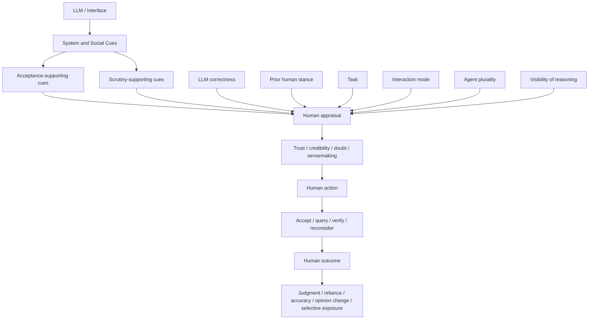

# Trabalho 4 - Codificação e síntese piloto de estudos primários

> **Versão:** v0.2  
> **Data:** 23/09/2026  
> **Disciplina:** Comunicação Científica - PPGI/UNIRIO  
> **Tema:** vieses cognitivos humanos em julgamentos mediados por LLMs, com atenção a sistemas multiagentes  
> **Escopo desta entrega:** codificação piloto de 5 reports previamente selecionados na Wave 1 do Trabalho 3  
> **Unidade de análise:** 5 REPORTS → 8 STUDY units  
> **Status:** síntese qualitativa preliminar; os achados não devem ser generalizados para toda a literatura

---

## 1. Objetivo da atividade

Esta entrega dá continuidade ao **Trabalho 3 - Mapeamento e seleção de estudos primários**, no qual foram selecionados 10 reports primários, correspondentes a 13 unidades empíricas.

O objetivo desta etapa é:

1. selecionar cinco artigos do corpus previamente incluído;
2. realizar leitura rápida orientada à extração;
3. aplicar codificação dedutiva a partir do planejamento preliminar;
4. incorporar códigos emergentes quando efetivamente sustentados pelos estudos;
5. analisar transversalmente as oito unidades empíricas contidas nos cinco reports;
6. agrupar códigos e mecanismos relacionados;
7. formular possíveis achados em formato **Claim → Evidence → Studies → Limitações**;
8. organizar os resultados para apresentação e discussão.

A análise desta entrega é deliberadamente **piloto**. Ela não substitui a síntese do corpus completo e não deve ser interpretada como evidência de ausência ou prevalência na literatura global.

---

## 2. Continuidade com o Trabalho 3

O Trabalho 3 estabeleceu a distinção entre:

- **REPORT:** publicação bibliográfica;
- **STUDY:** unidade empírica distinta dentro de um report.

Essa distinção foi mantida nesta etapa para evitar que artigos com múltiplos experimentos fossem tratados artificialmente como uma única observação.

A delimitação conceitual também foi preservada:

- o **humano é o sujeito cognitivo**;
- o LLM é tratado como sistema mediador;
- `confirmation bias` e `anchoring bias` pertencem ao núcleo de vieses cognitivos do projeto;
- `trust`, `reliance`, `overreliance`, `persuasion`, `social influence` e fenômenos semelhantes são tratados como **fenômenos relacionados**, e não como sinônimos automáticos de viés cognitivo;
- em sistemas multiagentes, múltiplos agentes são uma configuração arquitetural/interacional, não múltiplos sujeitos cognitivos humanos.

---

## 3. Seleção dos cinco reports

Os cinco reports foram selecionados **intencionalmente** entre os dez reports incluídos na Wave 1 do Trabalho 3, buscando maximizar a heterogeneidade conceitual e metodológica do piloto.

O objetivo não foi obter representatividade estatística, mas testar se o esquema preliminar de codificação é capaz de acomodar diferentes construtos, desenhos experimentais, mecanismos de interação e configurações single-LLM e multiagentes.

| Report | Study units | Foco principal | Papel no piloto |
|---|---|---|---|
| **FT1222** - *Generative Echo Chamber? Effects of LLM-Powered Search Systems on Diverse Information Seeking* | ST011; ST012 | Confirmation bias / selective exposure | Caso de viés cognitivo humano diretamente operacionalizado |
| **FT0070** - *Fostering Appropriate Reliance on Large Language Models: The Role of Explanations, Sources, and Inconsistencies* | ST001; ST002 | Reliance / overreliance / verification | Efeitos de explanations, sources e inconsistencies |
| **FT0072** - *Effects of LLM-based Search on Decision Making: Speed, Accuracy, and Overreliance* | ST003; ST004 | Decision accuracy / overreliance / confidence cues | Relação entre eficiência, erro e reliance |
| **FT0310** - *Multi-Agents are Social Groups: Investigating Social Influence of Multiple Agents in Human-Agent Interactions* | ST007 | Social influence / opinion change / polarization | Efeito da pluralidade de agentes |
| **FT0772** - *Sensemaking in Multi-Agent LLM Interfaces: How Users Interpret Transparency and Trustworthiness Cues* | ST010 | Sensemaking / perceived reliability / consensus / critique | Interpretação humana de cues multiagentes |

A amostra piloto contém, portanto:

```text
5 REPORTS
│
├── 1 report com viés cognitivo direto
│      FT1222
│
├── 2 reports sobre reliance / decisão
│      FT0070
│      FT0072
│
└── 2 reports sobre sistemas multiagentes
       FT0310
       FT0772

= 8 STUDY units
```

---

## 4. Estratégia de leitura e codificação

A leitura foi orientada à extração, priorizando:

1. problema e objetivo;
2. desenho da pesquisa;
3. participantes e amostra;
4. modelo ou sistema utilizado;
5. condições experimentais;
6. construtos e operacionalizações;
7. principais outcomes;
8. resultados;
9. limitações;
10. relação com as RQs da revisão.

A codificação adotou uma estratégia **híbrida**:

- **dedutiva:** códigos provenientes do planejamento, das RQs, do vocabulário controlado e do Trabalho 3;
- **indutiva/emergente:** códigos incorporados apenas quando o material empírico não era suficientemente descrito pelos códigos existentes.

Foi mantida a distinção entre:

```text
DADO EXTRAÍDO
    ↓
informação explicitamente reportada no estudo

CÓDIGO ANALÍTICO
    ↓
categoria aplicada pela revisão

MEMO ANALÍTICO
    ↓
interpretação provisória da revisão

ACHADO PRELIMINAR
    ↓
padrão transversal sustentado por mais de uma evidência
```

---

## 5. Codebook utilizado e refinado no piloto

### 5.1 Famílias dedutivas principais

| Família | Exemplos de códigos |
|---|---|
| **Locus** | `HUMAN`, `INTERACTION`, `MODEL`, `UNCLEAR` |
| **Viés cognitivo** | `CONFIRMATION_BIAS`, `ANCHORING_BIAS`, `AUTOMATION_BIAS`, `OTHER_COGNITIVE_BIAS` |
| **Fenômenos relacionados** | `RELIANCE`, `OVERRELIANCE`, `UNDERRELIANCE`, `APPROPRIATE_RELIANCE`, `TRUST`, `SOCIAL_INFLUENCE`, `OPINION_CHANGE` |
| **Arquitetura** | `SINGLE_LLM`, `MULTI_LLM`, `UNCLEAR` |
| **Mecanismos** | `EXPLANATION`, `SOURCE_CUE`, `UNCERTAINTY_CUE`, `CONFIDENCE_CUE`, `AGREEMENT`, `DISAGREEMENT`, `CONSENSUS`, `CRITIQUE`, `VERIFICATION`, `DEBATE` |
| **Outcomes** | `DECISION_ACCURACY`, `JUDGMENT_CHANGE`, `BELIEF_CHANGE`, `CONFIDENCE_CHANGE`, `INFORMATION_SEEKING`, `SELECTIVE_EXPOSURE`, `VERIFICATION_BEHAVIOR` |
| **Direção** | `AMPLIFIES`, `MITIGATES`, `NULL_EFFECT`, `MIXED_EFFECT`, `UNCLEAR` |

### 5.2 Refinamentos produzidos pelo piloto

A leitura dos cinco reports mostrou necessidade de distinguir:

```text
effect_direction
    ≠
support_status
    ≠
evidence_level
```

Foram utilizados:

- `effect_direction`: `AMPLIFIES`, `MITIGATES`, `NULL_EFFECT`, `MIXED_EFFECT`, `UNCLEAR`;
- `support_status`: `SUPPORTED`, `PARTIAL`, `NOT_SUPPORTED`, `EXPLORATORY`, `NOT_TESTED`;
- `evidence_level`: `DIRECT`, `INDIRECT`, `INTERPRETIVE`, `DIRECT_QUALITATIVE`.

Também foram refinados:

- `INTERACTION_MODE`;
- `IMPLEMENTATION_MODE`;
- `STANCE_ALIGNMENT`;
- `VERIFICATION_ACTION`;
- `UNRELIABILITY_CUE`;
- `NORMATIVE_INFLUENCE`;
- `INFORMATIONAL_INFLUENCE`;
- `OPINION_POLARIZATION`;
- `MAJORITY_HEURISTIC`;
- `ENSEMBLE_SIZE_HEURISTIC`;
- `TRANSPARENCY_SUFFICIENCY`;
- `MENTAL_WORKLOAD`;
- `PERCEIVED_AGENT_INDEPENDENCE`.

Um princípio importante que emergiu foi:

> **cue disponível não implica cue percebido, e cue percebido não implica necessariamente ação de verificação.**

---


### 5.3 Matriz de codificação aplicada às STUDY units

A tabela abaixo torna explícita a aplicação dos códigos às oito unidades empíricas do piloto. Ela não substitui os dados extraídos de cada estudo; sua função é mostrar quais categorias analíticas foram efetivamente utilizadas na síntese.

| Study | Viés / fenômeno | Arquitetura / implementação | Mecanismos e cues codificados | Outcomes codificados | Observações analíticas |
|---|---|---|---|---|---|
| **ST011** | `CONFIRMATION_BIAS`; `SELECTIVE_EXPOSURE` | `SINGLE_LLM`; busca conversacional | `INTERACTION_MODE`; `SOURCE_CUE` na condição com referências | `INFORMATION_SEEKING`; attitude change; argumentos; agreement/trust relacionados | aumento de `confirmatory querying`; efeitos posteriores não acompanharam o mesmo padrão |
| **ST012** | `CONFIRMATION_BIAS`; `SELECTIVE_EXPOSURE` | `SINGLE_LLM` | `STANCE_ALIGNMENT` (`CONSONANT`, `NEUTRAL`, `DISSONANT`) | `INFORMATION_SEEKING`; attitude change; argumentos; agreement/trust relacionados | condição consonante aumentou `confirmatory querying`; condição dissonante não produziu mitigação simétrica |
| **ST001** | `RELIANCE`; `OVERRELIANCE`; `UNDERRELIANCE` | `SINGLE_LLM`; `LIVE_MULTI_TURN_CONVERSATIONAL` | `EXPLANATION`; `SOURCE_CUE`; `INCONSISTENCY`; `VERIFICATION_ACTION` | accuracy; confidence; `VERIFICATION_BEHAVIOR` | estudo exploratório; mecanismos identificados em think-aloud |
| **ST002** | `APPROPRIATE_RELIANCE`; `OVERRELIANCE`; `UNDERRELIANCE` | representação `SINGLE_LLM`; `CONTROLLED_STATIC_RESPONSE` | `EXPLANATION`; `SOURCE_CUE`; `INCONSISTENCY`; `VERIFICATION_ACTION` | agreement; accuracy; confidence; source click | explanation aumentou reliance em respostas corretas e incorretas; sources e inconsistencies favoreceram melhor discriminação em condições específicas |
| **ST003** | `OVERRELIANCE` | `SINGLE_LLM`; `LIVE_MULTI_QUERY_NONCONVERSATIONAL` | busca baseada em LLM; ausência de cue explícito de incerteza | `DECISION_ACCURACY`; `TASK_TIME`; `QUERY_COUNT`; `QUERY_COMPLEXITY`; perceived reliability; user experience | maior eficiência, mas forte queda de accuracy na tarefa vulnerável a erro do LLM |
| **ST004** | `OVERRELIANCE` | `SINGLE_LLM`; `LIVE_MULTI_QUERY_NONCONVERSATIONAL` | `CONFIDENCE_CUE`; `UNRELIABILITY_CUE`; `VERIFICATION_ACTION` | `DECISION_ACCURACY`; `TASK_TIME`; `QUERY_COUNT`; perceived reliability; user experience | confidence highlighting aumentou checking e accuracy na tarefa problemática |
| **ST007** | `SOCIAL_INFLUENCE`; `OPINION_CHANGE`; `OPINION_POLARIZATION` | `SINGLE/MULTI_AGENT`; `HOMOGENEOUS_MULTI`; `SAME_MODEL` | `AGREEMENT`; `CONSENSUS`; `STANCE_ALIGNMENT`; `GROUP_SIZE` | `NORMATIVE_INFLUENCE`; `INFORMATIONAL_INFLUENCE`; opinion change; polarization | influência normativa aumentou em condições multiagentes; informational influence não apresentou aumento significativo |
| **ST010** | `SENSEMAKING`; `PERCEIVED_RELIABILITY` | `MULTI_AGENT_INTERFACE_REPRESENTATION`; `PREGENERATED_MULTI_AGENT` | `DISAGREEMENT`; `CRITIQUE`; `DEBATE`; `CONSENSUS`; rationales; majority vote | perceived reliability; transparency; helpfulness; reliance intention | `MAJORITY_HEURISTIC`, `TRANSPARENCY_SUFFICIENCY` e carga cognitiva emergiram da análise qualitativa |

**Nota:** quando um termo aparece na coluna de outcome sem formatação em código, ele é mantido como medida/descritivo extraído do artigo e não necessariamente como código estabilizado do codebook.

### 5.4 Proveniência dos códigos: a priori e emergentes

Para manter a rastreabilidade entre o planejamento preliminar e o que emergiu durante a leitura, os códigos foram classificados pela sua origem.

| Código / campo | Origem | Primeiro observado ou refinado no piloto | Status |
|---|---|---|---|
| `CONFIRMATION_BIAS` | A priori | planejamento / Trabalho 3 | Dedutivo |
| `ANCHORING_BIAS` | A priori | planejamento / Trabalho 3 | Dedutivo; **não observado nos 5 reports** |
| `AUTOMATION_BIAS` | A priori | planejamento / Trabalho 3 | Dedutivo; **não operacionalizado diretamente nos 5 reports** |
| `RELIANCE` | A priori | planejamento / Trabalho 3 | Dedutivo |
| `OVERRELIANCE` | A priori | planejamento / Trabalho 3 | Dedutivo |
| `APPROPRIATE_RELIANCE` | A priori | planejamento / Trabalho 3 | Dedutivo |
| `EXPLANATION` | A priori | planejamento / Trabalho 3 | Dedutivo |
| `SOURCE_CUE` | A priori | planejamento / Trabalho 3 | Dedutivo |
| `UNCERTAINTY_CUE` / `CONFIDENCE_CUE` | A priori | planejamento / Trabalho 3 | Dedutivo |
| `AGREEMENT`, `DISAGREEMENT`, `CONSENSUS`, `CRITIQUE`, `VERIFICATION`, `DEBATE` | A priori | planejamento / Trabalho 3 | Dedutivos |
| `STANCE_ALIGNMENT` | Emergente | FT1222 | **Aceito** |
| `INTERACTION_MODE` | Emergente / refinamento metodológico | FT0070; refinado em FT0072 | **Aceito** |
| `VERIFICATION_ACTION` | Emergente | FT0070 | **Aceito** |
| `UNRELIABILITY_CUE` | Emergente | FT0070 | **Aceito** |
| `NORMATIVE_INFLUENCE` | Emergente / refinamento de constructo | FT0310 | **Aceito** |
| `INFORMATIONAL_INFLUENCE` | Emergente / refinamento de constructo | FT0310 | **Aceito** |
| `OPINION_POLARIZATION` | Emergente / outcome específico | FT0310 | **Aceito** |
| `GROUP_SIZE` | Emergente como variável de condição | FT0310 | **Aceito** |
| `IMPLEMENTATION_MODE` | Emergente / refinamento metodológico | FT0772 | **Aceito** |
| `MAJORITY_HEURISTIC` | Emergente | FT0772 | **Aceito** |
| `ENSEMBLE_SIZE_HEURISTIC` | Emergente | FT0772 | **Aceito** |
| `TRANSPARENCY_SUFFICIENCY` | Emergente | FT0772 | **Aceito** |
| `MENTAL_WORKLOAD` | Emergente / outcome qualitativo | FT0772 | **Aceito** |
| `PERCEIVED_AGENT_INDEPENDENCE` | Emergente | FT0772 | **Candidate** |
| `PSYCHOLOGICAL_REACTANCE` | Interpretação dos autores | FT0310 | **Memo; não tratado como outcome medido** |

A inclusão de um código emergente exigiu evidência no estudo e necessidade analítica não suficientemente coberta pelos códigos existentes. Códigos emergentes podem ser posteriormente fundidos, refinados ou removidos quando o corpus for ampliado.

---

## 6. Síntese das oito STUDY units

| Study | Desenho / condição principal | Fenômeno principal | Resultado factual resumido |
|---|---|---|---|
| **ST011** | Web search vs conversational LLM search | Confirmation bias / selective exposure | Busca conversacional apresentou mais `confirmatory querying`; não houve diferença significativa correspondente em attitude change ou argumentos |
| **ST012** | LLM consonante / neutro / dissonante | Confirmation bias / selective exposure | Condição consonante aumentou fortemente `confirmatory querying`; a condição dissonante não apresentou mitigação simétrica |
| **ST001** | Think-aloud com ChatGPT-4o | Reliance / overreliance / verification | Explanations, sources e inconsistencies emergiram como elementos usados pelos participantes ao decidir quanto confiar e verificar |
| **ST002** | Accuracy × explanation × sources | Appropriate reliance / overreliance | Explanation aumentou reliance em respostas corretas e incorretas; sources favoreceram melhor discriminação; inconsistencies reduziram agreement com respostas incorretas |
| **ST003** | Traditional search vs LLM search | Decision accuracy / overreliance | LLM search reduziu tempo; nas tarefas fáceis accuracy foi comparável, mas caiu fortemente na tarefa vulnerável a erro do LLM |
| **ST004** | Confidence highlighting | Overreliance / verification | Cues de baixa confiança aumentaram follow-up queries e accuracy na tarefa problemática, com aumento de tempo |
| **ST007** | 1 vs 3 vs 5 agentes; same/different stance | Social influence / opinion change / polarization | Condições multiagentes aumentaram normative influence; informational influence não aumentou significativamente; efeitos de opinion change não foram monotônicos |
| **ST010** | Majority, rationales, critique, debate, consensus | Sensemaking / perceived reliability | Majority e consensus foram usados como cues de confiabilidade; disagreement, critique e debate tiveram efeitos dependentes de apresentação e custo cognitivo |

---

## 7. Agrupamentos axiais

A codificação axial reorganizou os códigos artigo a artigo em cinco grupos transversais.

### G1 - Cues de aceitação e confiabilidade

Inclui elementos como:

- explanations;
- majority;
- consensus;
- number of agents;
- stance alignment.

Esses elementos podem alterar aceitação, reliance, influência social ou confiabilidade percebida. Entretanto, os estudos não demonstram que tais cues sejam necessariamente indicadores de qualidade real da informação.

### G2 - Cues e ações de scrutiny/verificação

Inclui:

- sources;
- inconsistencies;
- low-confidence cues;
- explained disagreement;
- critique;
- verification actions.

Esses elementos tornam possível erro, incerteza, conflito ou evidência externa mais visíveis e, em algumas condições, favorecem escrutínio adicional.

### G3 - Alinhamento com posição prévia

`STANCE_ALIGNMENT` mostrou-se relevante em FT1222 e FT0310.

A posição do sistema em relação à posição prévia do participante altera o tipo de outcome observado. Consonância, discordância e pressão social não podem ser tratados como um único mecanismo de persuasão.

### G4 - Pluralidade multiagente e influência social

FT0310 e FT0772 mostram que:

- número de agentes;
- majority agreement;
- consensus;
- disagreement;
- critique;

podem adquirir significado social ou heurístico para os participantes.

Entretanto, esses estudos não demonstram que maior pluralidade corresponda a maior independência epistemológica real ou a melhor desempenho decisório.

### G5 - Percepção × comportamento × performance

Os estudos mostram que essas três dimensões podem divergir:

```text
SUBJECTIVE PERCEPTION
        ≠
OBSERVED BEHAVIOR
        ≠
DECISION PERFORMANCE
```

Por isso, `trust`, `perceived reliability`, `reliance`, `information-seeking behavior` e `accuracy` foram mantidos como constructs distintos.

---

## 8. Modelo analítico provisório

A codificação axial sugere o seguinte modelo provisório:



Este modelo é uma **síntese analítica da revisão**, não um modelo proposto pelos autores dos cinco artigos.

---

## 9. Possíveis achados

Os achados abaixo são classificados como **preliminares**, derivados da amostra piloto.

### PF1 - Credibilidade percebida não implica calibração

**Claim**

> Características da resposta ou da interface que aumentam aceitação, influência social ou confiabilidade percebida não necessariamente melhoram a capacidade humana de discriminar informação correta de informação incorreta.

**Evidence**

- **ST002:** explanations aumentaram reliance diante de respostas corretas e incorretas.
- **ST007:** pluralidade aumentou normative influence, sem aumento significativo de informational influence.
- **ST010:** majority e consensus foram usados como cues de confiabilidade, mas o estudo não testou calibração diante de outputs finais incorretos.

**Limitações**

Os três estudos utilizam outcomes diferentes. Não é correto agregá-los como uma única medida de calibração.

**Versão curta**

> **Cues de credibilidade podem aumentar aceitação sem necessariamente melhorar a calibração do julgamento.**

---

### PF2 - Cues de possível falha podem favorecer scrutiny

**Claim**

> Cues que tornam incerteza, inconsistência ou evidência externa mais visíveis podem estimular verificação e escrutínio e, em determinadas condições, reduzir overreliance ou melhorar a acurácia da decisão.

**Evidence**

- **ST001:** inconsistências e fontes foram usadas por participantes para questionar ou verificar respostas.
- **ST002:** sources favoreceram melhor discriminação entre respostas corretas e incorretas; inconsistencies reduziram agreement com respostas incorretas.
- **ST004:** confidence highlighting aumentou follow-up queries e accuracy na tarefa problemática.
- **ST010:** explained disagreement e critique apoiaram sensemaking, mas o efeito sobre accuracy não foi testado.

**Limitações**

Parte da evidência é exploratória ou qualitativa. Não há evidência de que qualquer cue de incerteza produza o mesmo efeito em qualquer contexto.

**Versão curta**

> **Cues de possível falha parecem ser mais úteis quando ajudam o usuário a verificar a resposta.**

---

### PF3 - Os efeitos são condicionais e não monotônicos

**Claim**

> Nos cinco reports analisados, os efeitos da mediação por LLM dependem da correção da resposta, da posição prévia do usuário, da tarefa e da forma de apresentação dos cues; não emerge uma relação geral segundo a qual mais explicação, transparência ou agentes produzam melhores resultados.

**Evidence**

- **ST002:** explanation teve consequências diferentes conforme a correção do LLM.
- **ST012:** consonância aumentou confirmatory querying, enquanto dissonância não produziu mitigação simétrica.
- **ST007:** os efeitos de 1, 3 e 5 agentes não foram monotônicos.
- **ST010:** a quantidade de transparência considerada útil variou com tarefa e custo cognitivo.

**Limitações**

Os moderadores aparecem em desenhos diferentes. Não foi testado um único modelo causal comum aos cinco reports.

**Versão curta**

> **No piloto, não apareceu um padrão “mais é melhor”: os efeitos dependem da condição e do contexto.**

---

### PF4 - Percepção, comportamento e performance não são equivalentes

**Claim**

> Percepção subjetiva, comportamento observável e desempenho decisório podem divergir; por isso, trust, perceived reliability, reliance, comportamento de busca e accuracy não devem ser tratados como medidas intercambiáveis.

**Evidence**

- **ST011:** aumento de confirmatory querying sem diferença significativa correspondente em attitude change.
- **ST003:** forte queda de accuracy na tarefa problemática sem diferença significativa correspondente em perceived reliability.
- **ST004:** melhora de accuracy com confidence cues sem diferença significativa correspondente nas avaliações globais de reliability/experience.
- **ST010:** mede percepção e sensemaking, mas não behavioral reliance ou trust calibration.

**Limitações**

A divergência entre medidas não significa que elas sejam independentes ou não relacionadas.

**Versão curta**

> **O que o usuário percebe, o que ele faz e a qualidade da decisão não necessariamente se movem juntos.**

---

### PF5 - Pluralidade multiagente pode funcionar como cue social/heurístico

**Claim**

> Nos dois estudos multiagentes do piloto, pluralidade, maioria e consenso aparecem como sinais social ou heuristicamente relevantes para o julgamento humano, mas as evidências não estabelecem que esses sinais correspondam a maior independência epistemológica entre agentes ou a maior acurácia do sistema.

**Evidence**

- **ST007:** condições multiagentes aumentaram normative influence, enquanto informational influence não aumentou significativamente; os agentes compartilhavam o mesmo backend.
- **ST010:** agent count, majority e consensus foram frequentemente interpretados como cues de confiabilidade; o estudo utilizou interfaces pré-geradas e não manipulou independência epistemológica real.

**Limitações**

A evidência provém apenas de dois studies, com métodos e outcomes distintos. Nenhum estudo manipulou diretamente:

```text
PERCEIVED PLURALITY
        ×
ACTUAL EPISTEMIC INDEPENDENCE
```

**Versão curta**

> **Mais agentes podem significar “mais influência” ou “mais confiabilidade percebida” sem demonstrar que existam mais evidências independentes.**

---

## 10. Lacuna candidata emergente

A síntese dos dois estudos multiagentes sugere uma lacuna que merece acompanhamento na expansão da revisão.

### RG-CANDIDATE-01 - Perceived Agent Plurality vs. Epistemic Independence

**Status:** `CANDIDATE GAP - PILOT EVIDENCE`

**Formulação provisória**

> Há evidência ainda limitada sobre como a discrepância entre pluralidade percebida e independência epistemológica real em sistemas multiagentes baseados em LLMs afeta o julgamento humano. Em particular, permanece pouco compreendido se usuários interpretam múltiplos agentes concordantes como fontes independentes de evidência e se essa percepção altera reliance, confiança, verificação, mudança de opinião ou vieses cognitivos.

### O que os cinco artigos permitem afirmar

- pluralidade pode produzir influência social;
- majority e consensus podem ser usados como cues de confiabilidade;
- alguns usuários constroem modelos mentais sobre múltiplos agentes;
- o número de agentes não produz necessariamente efeitos monotônicos.

### O que os cinco artigos não permitem afirmar

- que usuários necessariamente confundem pluralidade com independência;
- que consenso multiagente aumenta accuracy;
- que múltiplos agentes são epistemicamente independentes;
- que a diferença entre independência real e percebida causa overreliance;
- que esse mecanismo amplifica confirmation bias ou anchoring bias.

### Teste necessário para fortalecer a lacuna

Uma investigação futura poderia manipular explicitamente:

```text
PLURALIDADE PERCEBIDA
        ×
INDEPENDÊNCIA EPISTEMOLÓGICA REAL
```

por exemplo, comparando múltiplos agentes baseados no mesmo modelo/evidência com agentes efetivamente independentes em modelo, evidência ou processo.

Nesta entrega, entretanto, essa proposição permanece **lacuna candidata**, não conclusão da literatura.

---

## 11. Formulações que a análise não sustenta

A codificação também permitiu restringir interpretações fortes demais.

| Formulação | Avaliação no piloto |
|---|---|
| “Mais explicações reduzem overreliance.” | **Não sustentada.** Explanation também pode aumentar reliance diante de respostas erradas. |
| “Mais transparência é sempre melhor.” | **Não sustentada.** Benefícios são dependentes da tarefa e podem gerar carga cognitiva. |
| “Mais agentes persuadem mais.” | **Não sustentada.** FT0310 apresenta efeitos não monotônicos. |
| “Mais agentes são percebidos como melhor evidência.” | **Não sustentada como regra geral.** Evidência qualitativa existe, mas FT0310 não encontrou aumento de informational influence. |
| “Discordância reduz confiança.” | **Excessivamente simples.** Discordância sem explicação e discordância acompanhada de rationale são interpretadas de forma diferente. |
| “Informação contrária reduz confirmation bias.” | **Não sustentada pelo FT1222.** A condição dissonante não produziu mitigação simétrica. |
| “Multi-agent influencia confirmation bias.” | **Não demonstrado nos cinco reports.** |
| “Consensus melhora accuracy.” | **Não demonstrado.** |
| “Trust e reliance são equivalentes.” | **Não sustentado.** |

---

## 12. Síntese geral do piloto

A análise das oito STUDY units não sustenta uma afirmação ampla de que “LLMs amplificam vieses”.

A síntese preliminar é mais específica:

> **Nos cinco artigos analisados, os efeitos da mediação por LLM dependem de como a interação apresenta sinais de credibilidade, incerteza, verificação, alinhamento e consenso. Esses sinais podem alterar busca de informação, reliance, percepção de confiabilidade, influência social e desempenho, mas seus efeitos são condicionais e esses outcomes não são intercambiáveis. Em configurações multiagentes, pluralidade e consenso apresentam efeitos sociais e heurísticos relevantes, porém o piloto ainda não demonstra que representem independência epistemológica ou melhor qualidade da decisão.**

A codificação também reforça uma distinção metodológica importante:

```text
CUE DISPONÍVEL
      ↓
CUE PERCEBIDO
      ↓
CUE UTILIZADO
      ↓
OUTCOME HUMANO
```

Esses quatro níveis não devem ser tratados como equivalentes.

---

## 13. Limitações desta entrega

Esta versão possui limitações explícitas:

- utiliza apenas **5 dos 10 reports** incluídos na Wave 1;
- contém **8 STUDY units**, algumas provenientes do mesmo report;
- constitui uma seleção intencional heterogênea para pilotagem, e não amostra representativa;
- os studies utilizam diferentes construtos, tarefas, modelos, interfaces e outcomes;
- não foi realizada meta-análise;
- nem todos os studies fornecem evidência causal;
- ST001 e ST010 têm forte componente exploratório/qualitativo;
- FT0310 e FT0772 são os únicos reports diretamente multiagentes neste piloto;
- a lacuna sobre independência epistemológica é apenas candidata;
- a ausência de anchoring bias nos cinco reports não significa ausência na literatura;
- os possíveis achados permanecem sujeitos a revisão quando o corpus for ampliado.

---

## 14. Referências dos cinco reports

1. Sharma, N.; Liao, Q. V.; Xiao, Z. (2024). *Generative Echo Chamber? Effects of LLM-Powered Search Systems on Diverse Information Seeking*. Proceedings of the CHI Conference on Human Factors in Computing Systems. DOI: `10.1145/3613904.3642459`.

2. Kim, S. S. Y.; Vaughan, J. W.; Liao, Q. V.; Lombrozo, T.; Russakovsky, O. (2025). *Fostering Appropriate Reliance on Large Language Models: The Role of Explanations, Sources, and Inconsistencies*. Proceedings of the CHI Conference on Human Factors in Computing Systems. DOI: `10.1145/3706598.3714020`.

3. Spatharioti, S. E.; Rothschild, D.; Goldstein, D. G.; Hofman, J. M. (2025). *Effects of LLM-based Search on Decision Making: Speed, Accuracy, and Overreliance*. Proceedings of the CHI Conference on Human Factors in Computing Systems. DOI: `10.1145/3706598.3714082`.

4. Song, T.; Tan, Y.; Zhu, Z.; Feng, Y.; Lee, Y.-C. (2025). *Multi-Agents are Social Groups: Investigating Social Influence of Multiple Agents in Human-Agent Interactions*. Proceedings of the ACM on Human-Computer Interaction. DOI: `10.1145/3757633`.

5. Pareek, S.; Govers, J.; Kollerup, N. K.; Wong, E.; Velloso, E.; Goncalves, J. (2026). *Sensemaking in Multi-Agent LLM Interfaces: How Users Interpret Transparency and Trustworthiness Cues*. Proceedings of the CHI Conference on Human Factors in Computing Systems. DOI: `10.1145/3772318.3791157`.

---

## 15. Relação com a próxima etapa da revisão

Os resultados desta codificação devem ser utilizados para:

1. estabilizar o codebook antes da aplicação ao corpus ampliado;
2. verificar se os cinco possíveis achados reaparecem em novos studies;
3. testar se a lacuna `Perceived Agent Plurality vs. Epistemic Independence` permanece após expansão da evidência;
4. recuperar estudos diretamente relacionados a anchoring bias;
5. manter separados vieses cognitivos diretos, fenômenos associados e mecanismos de interação;
6. preservar a distinção entre percepção, comportamento e desempenho na síntese final.

---

## 16. Nota de rastreabilidade

Esta entrega constitui uma **síntese qualitativa piloto** derivada dos cinco reports selecionados a partir da Wave 1 documentada no Trabalho 3.

Os códigos emergentes, agrupamentos axiais, possíveis achados e a lacuna candidata são **produtos analíticos desta revisão**. Eles não devem ser atribuídos individualmente aos autores dos estudos quando não correspondem a categorias ou conclusões explicitamente apresentadas nos artigos.
