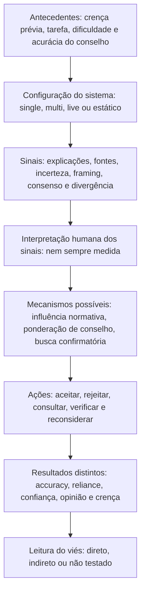

# Semana 08 - Trabalho 6: Codificação de 10 artigos

**PPGI/UNIRIO - Comunicação Científica | 08/10/2026**  
**Pesquisa:** vieses cognitivos humanos em julgamentos mediados por LLMs, com atenção a sistemas multiagentes.  
**Release:** v0.1 - codificação qualitativa integrada, `AI-assisted`, sujeita à conferência humana.

> **Escopo executado:** 10 **REPORTS** / 13 **STUDY units**, provenientes da Wave 1 já selecionada na Semana 04. No Trabalho 4, cinco reports (oito studies) haviam sido codificados em piloto; agora o mapeamento engloba os outros cinco reports (cinco studies). Não foram incluídos novos artigos nem alterado o screening. Os códigos transferidos do piloto e os novos permanecem identificados no CSV. **Não se reivindica saturação teórica**, validação independente, meta-análise ou dupla codificação humana.

## 1. Fundamentação metodológica: duas leituras obrigatórias

### 1.1 Wolfswinkel, Furtmueller e Wilderom - Grounded Theory na revisão

**Referência:** WOLFSWINKEL, J. F.; FURTMUELLER, E.; WILDEROM, C. P. M. *Using grounded theory as a method for rigorously reviewing literature*. European Journal of Information Systems, 2011. DOI: https://doi.org/10.1057/ejis.2011.51.  
O artigo propõe cinco fases **Define → Search → Select → Analyze → Present**, executadas iterativamente. Para a Semana 08, nosso foco é a fase **Analyze**, em três movimentos interdependentes:

- **Codificação aberta:** destacar excertos concretos e identificar conceitos, acontecimentos, atores, condições e propriedades sem transformar toda observação em viés psicológico.
- **Codificação axial:** agrupar conceitos e explicitar propriedades, condições, mecanismos e relações entre categorias, mediante comparação constante entre reports.
- **Codificação seletiva:** integrar categorias centrais numa explicação provisória coerente; registrar condições de contorno, evidências conflitantes e proposições testáveis. Manter memos, datas e origem de cada interpretação.

O texto mostra que categorias são revisáveis e que os três níveis não são necessariamente uma sequência linear. A atividade aqui **usa técnicas analíticas orientadas por Grounded Theory**; não constitui uma Grounded Theory completa nem demonstra saturação a partir de 10 publicações.

### 1.2 Leidner e Tona - Thought-Gear

**Referência:** LEIDNER, D. E.; TONA, O. *A Thought-Gear Model of Theorizing from Literature*. Journal of the Association for Information Systems, 22(4), 2021. DOI: https://doi.org/10.17705/1jais.00683.  
O modelo inclui *theory genesis*, quatro engrenagens e *theory composition*:

1. **Informing Thoughts:** ler, anotar, extrair, codificar e organizar os textos.
2. **Generating Thoughts:** questionar interpretações, explorar alternativas e debater tensões.
3. **Materializing Thoughts:** explicitar padrões em matrizes, desenhos e modelos.
4. **Building Theory Elements from Thoughts:** definir construtos, relações, mecanismos e *boundary conditions*; formular proposições.

Na **Figura 1 (p. 875)**, as engrenagens são iterativas, e a **Figura 4 (p. 880)** exemplifica a matriz de codificação da literatura. O modelo não autoriza transformar hipóteses do revisor em achados comprovados.

### 1.3 Integração com o nosso protocolo

A etapa de seleção dos dez artigos já foi conduzida segundo o protocolo de mapeamento documentado no Trabalho 3; **SEGRESS** permanece referência de *relato/transparência*. Grounded Theory orienta o trabalho analítico, e Thought-Gear orienta a construção de modelos conceituais. Estas associações são **decisões metodológicas próprias da nossa pesquisa** e não instruções textuais de SEGRESS. QAISER avalia a qualidade de **revisões sistemáticas**, e não será aplicado aos dez estudos primários.

## 2. Princípios de rigor e proveniência

- `REPORT` identifica a publicação; `STUDY` identifica experimento ou investigação empírica distinta dentro da publicação.
- `PILOTO_T4` = reconsolidação de Trabalho 4 v0.2; `COMPLEMENTO_SEMANA08` = codificação acrescentada nesta entrega com consulta às fontes primárias disponíveis.
- `EVIDÊNCIA DOS AUTORES` = afirmação do próprio estudo, preferencialmente com página/seção e medida; `INTERPRETAÇÃO DA REVISÃO` = inferência provisória do pesquisador.
- **Cue** (sinal de interface) não equivale a **mecanismo psicológico**. *Trust*, *reliance*, verificação observada, acurácia e mudança de opinião são construtos distintos.
- `DIRECT`, `DIRECT_QUALITATIVE`, `INTERPRETIVE` e variantes referem-se ao tipo de sustentação; `NOT_TESTED` não equivale a resultado nulo.
- Nas avaliações, o **locus cognitivo** primário é humano. Um texto do modelo com enquadramento ideológico não é, por si, uma medida de viés cognitivo humano.
- Esta é uma codificação assistida, **não uma segunda avaliação humana independente**; checagem humana e registro de excertos precisos ainda são atividades pendentes.

## 3. Matriz da codificação aberta - os 10 artigos

| Report | Studies | Fenômeno / atores | Antecedentes e sinais | Resultados / consequência observada | Suporte | 
|---|---|---|---|---|---|
| **FT0070** | ST001, ST002 | RELIANCE, OVERRELIANCE, UNDERRELIANCE, VERIFICATION_BEHAVIOR; Participante humano; ChatGPT-4o | Tarefa de julgamento com respostas de qualidade variável; EXPLANATION, SOURCE_CUE, INCONSISTENCY | Relatos e comportamentos mostram diferentes maneiras de interpretar explicações, fontes e inconsistências; achado exploratório / Explicações aumentam reliance tanto para respostas certas quanto erradas; fontes e inconsistências podem melhorar discriminação em condições específicas | [PILOTO_T4](https://doi.org/10.1145/3706598.3714020) |
| **FT0072** | ST003, ST004 | OVERRELIANCE, DECISION_ACCURACY; Usuários; interface de busca LLM ou tradicional | Tarefas com diferentes dificuldades e erros de LLM; LLM_SEARCH_VS_TRADITIONAL | Busca LLM diminui tempo; acurácia inferior na tarefa vulnerável a erro da IA / Sinais de baixa confiança favoreceram follow-up e acerto na tarefa problemática, com maior tempo | [PILOTO_T4](https://doi.org/10.1145/3706598.3714082) |
| **FT0080** | ST005 | APPROPRIATE_RELIANCE, OVERRELIANCE, UNDERRELIANCE, TRUST_CALIBRATION; Participantes; conselheiro LLM | Resposta independente inicial; LSAT e estimativa visual; conselho posterior; RELIANCE_DISCLAIMER, UNCERTAINTY_HIGHLIGHTING, IMPLICIT_ANSWER | Intervenções geralmente reduziram overreliance sem melhorar reliance apropriada; disclaimer melhorou medida em LSAT; implicit answer exige mais tempo | [COMPLEMENTO_SEMANA08](https://arxiv.org/html/2412.15584v3) |
| **FT0083** | ST006 | PERSUASION, OPINION_CHANGE; Debatedor humano; oponente humano ou GPT-4 | Posição inicial; tema; informações sobre debatedor; OPPONENT_TYPE, PERSONALIZATION | GPT-4 personalizado superou referência humano-humano; comparação direta personalizado vs GPT-4 sem personalização NÃO foi significativa (p=0,0678 após correção) | [COMPLEMENTO_SEMANA08](https://doi.org/10.1038/s41562-026-02588-0) |
| **FT0310** | ST007 | SOCIAL_INFLUENCE, NORMATIVE_INFLUENCE, INFORMATIONAL_INFLUENCE, OPINION_CHANGE; Participante humano; múltiplos agentes LLM | Tamanho de grupo e posições convergentes/divergentes; GROUP_SIZE, STANCE_ALIGNMENT, AGREEMENT, CONSENSUS | Condições multiagentes elevaram influência normativa; a informacional não cresceu significativamente; resultados de opinião não monotônicos | [PILOTO_T4](https://doi.org/10.1145/3757633) |
| **FT0318** | ST008 | BELIEF_CHANGE, CONSPIRACY_BELIEF_CORRECTION; Participante; GPT-4o | Confiança prévia em crença conspiratória ou epistêmica não fundamentada; SOURCE_IDENTITY_LABEL, HUMAN_LIKE_TONE, FACT_BASED_ARGUMENTS | Queda aproximada de 10 pontos para crenças conspiratórias e 5 para outras crenças; sem diferença significativa entre rótulo AI/expert ou tom humano/neutro | [COMPLEMENTO_SEMANA08](https://doi.org/10.1093/pnasnexus/pgaf325) |
| **FT0545** | ST009 | OPINION_CHANGE, IDEOLOGICAL_FRAMING_EXPOSURE; Leitores humanos; resumos GPT-4o; Wikipedia como controle | Ideologia prévia; dois eventos históricos; DEFAULT_LLM_FRAMING, PROMPTED_LIBERAL_FRAMING, PROMPTED_CONSERVATIVE_FRAMING | Comparado a Wikipedia, default +0,10 (d=0,14), liberal +0,21 (d=0,28), conservador −0,11 (d=−0,13); efeito conservador sobretudo em leitores conservadores | [COMPLEMENTO_SEMANA08](https://doi.org/10.1093/pnasnexus/pgag022) |
| **FT0772** | ST010 | SENSEMAKING, PERCEIVED_RELIABILITY, TRUST; Participantes; representações de agentes na interface | Apresentação de consenso, crítica e divergência; MAJORITY, RATIONALES, CRITIQUE, DEBATE, CONSENSUS | Maioria/consenso interpretados como pistas de confiança; efeitos de discordância e crítica dependem da apresentação e do custo cognitivo | [PILOTO_T4](https://doi.org/10.1145/3772318.3791157) |
| **FT1222** | ST011, ST012 | CONFIRMATION_BIAS, SELECTIVE_EXPOSURE; Usuários; sistema de busca | Crença/posição inicial e modalidade de busca; INTERACTION_MODE | Busca conversacional promoveu mais consultas confirmatórias; resultados posteriores não aumentaram simetricamente / Consonância elevou consultas confirmatórias; dissonância não mostrou mitigação simétrica | [PILOTO_T4](https://doi.org/10.1145/3613904.3642459) |
| **FT1233** | ST013 | RELIANCE, TRUST, OVERRELIANCE; Participantes; motor de busca LLM simulado | Questões médicas; resposta LLM disponível ou indisponível; FIRST_PERSON_UNCERTAINTY, GENERAL_UNCERTAINTY | Concordância 80,9% controle, 74,8% primeira pessoa (diferença significativa), 77,6% geral (não significativa); acurácia maior em primeira pessoa | [COMPLEMENTO_SEMANA08](https://facctconference.org/static/papers24/facct24-56.pdf) |

## 4. Codificação aberta detalhada - as 5 unidades complementadas nesta semana

A matriz CSV contém **13 linhas**, com *fenômenos, atores, antecedentes, contexto, cues, mecanismos, outcomes, contradições, lacunas, categoria axial, nível e localizador de fonte*. Para os oito studies do piloto, o trabalho preserva os resultados descritos no Trabalho 4. Para os cinco restantes, o registro analítico detalhado é:

### ST005 / FT0080 - To Rely or Not to Rely? Evaluating Interventions for Appropriate Reliance on Large Language Models

**Fenômeno e atores:** APPROPRIATE_RELIANCE, OVERRELIANCE, UNDERRELIANCE, TRUST_CALIBRATION; Participantes; conselheiro LLM.  
**Antecedentes e contexto:** Resposta independente inicial; LSAT e estimativa visual; conselho posterior; Tarefas de julgamento com conselho controlado.  
**Sinais/intervenções:** RELIANCE_DISCLAIMER, UNCERTAINTY_HIGHLIGHTING, IMPLICIT_ANSWER.  
**Mecanismo codificado / distinção epistêmica:** Intervenções alteram aceitação; carga de processamento como interpretação analítica, não mecanismo mediador identificado.  
**Consequências/medidas:** Relative LLM Reliance; Relative Self-Reliance; Appropriate Reliance Ratio; confiança; tempo.  
**Evidência dos autores:** Intervenções geralmente reduziram overreliance sem melhorar reliance apropriada; disclaimer melhorou medida em LSAT; implicit answer exige mais tempo.  
**Contradição/tensão:** Redução de overreliance pode coincidir com underreliance; confiança subjetiva pode ficar mal calibrada.  
**Ausências/limitações:** Tarefas específicas; sem teste multiagente nem medida de confirmation bias.  
**Proveniência:** [Bo et al. (2025), abstract, §§3–5, métricas de reliance](https://arxiv.org/html/2412.15584v3).  
**Categoria axial proposta (interpretação do revisor):** AX01, AX02, AX05.  

### ST006 / FT0083 - On the conversational persuasiveness of GPT-4

**Fenômeno e atores:** PERSUASION, OPINION_CHANGE; Debatedor humano; oponente humano ou GPT-4.  
**Antecedentes e contexto:** Posição inicial; tema; informações sobre debatedor; Debate multirrodadas.  
**Sinais/intervenções:** OPPONENT_TYPE, PERSONALIZATION.  
**Mecanismo codificado / distinção epistêmica:** Persuasão via argumentos; mediação psicológica específica não isolada.  
**Consequências/medidas:** Mudança de concordância com posição oponente.  
**Evidência dos autores:** GPT-4 personalizado superou referência humano-humano; comparação direta personalizado vs GPT-4 sem personalização NÃO foi significativa (p=0,0678 após correção).  
**Contradição/tensão:** Errata 03/09/2026 invalidou declaração de significância incremental da personalização vs GPT-4 não personalizado.  
**Ausências/limitações:** Persuasão não constitui demonstração direta de viés cognitivo; sem multi-LLM.  
**Proveniência:** [Salvi et al. (2025) Aggregate Results; Correção de setembro/2026](https://doi.org/10.1038/s41562-026-02588-0).  
**Categoria axial proposta (interpretação do revisor):** AX03.  

### ST008 / FT0318 - Dialogues with large language models reduce conspiracy beliefs even when the AI is perceived as human

**Fenômeno e atores:** BELIEF_CHANGE, CONSPIRACY_BELIEF_CORRECTION; Participante; GPT-4o.  
**Antecedentes e contexto:** Confiança prévia em crença conspiratória ou epistêmica não fundamentada; Diálogo de duas rodadas.  
**Sinais/intervenções:** SOURCE_IDENTITY_LABEL, HUMAN_LIKE_TONE, FACT_BASED_ARGUMENTS.  
**Mecanismo codificado / distinção epistêmica:** Confrontação com argumentos factuais é explicação plausível; efeito mediador específico não isolado.  
**Consequências/medidas:** Confiança na crença (0–100), antes/depois.  
**Evidência dos autores:** Queda aproximada de 10 pontos para crenças conspiratórias e 5 para outras crenças; sem diferença significativa entre rótulo AI/expert ou tom humano/neutro.  
**Contradição/tensão:** Identidade declarada do interlocutor não afetou significativamente a redução de crença; rótulo expert não garantiu percepção humana.  
**Ausências/limitações:** Sem operacionalização de confirmation bias e sem controle sem argumento corretivo equivalente.  
**Proveniência:** [Boissin et al. (2025), Abstract, Results, Discussion, Fig. 1](https://doi.org/10.1093/pnasnexus/pgaf325).  
**Categoria axial proposta (interpretação do revisor):** AX03, AX05.  

### ST009 / FT0545 - How latent and prompting biases in AI-generated historical narratives influence opinions

**Fenômeno e atores:** OPINION_CHANGE, IDEOLOGICAL_FRAMING_EXPOSURE; Leitores humanos; resumos GPT-4o; Wikipedia como controle.  
**Antecedentes e contexto:** Ideologia prévia; dois eventos históricos; Exposição a texto histórico gerado ou de Wikipedia.  
**Sinais/intervenções:** DEFAULT_LLM_FRAMING, PROMPTED_LIBERAL_FRAMING, PROMPTED_CONSERVATIVE_FRAMING.  
**Mecanismo codificado / distinção epistêmica:** Enquadramento narrativo; motivated reasoning discutível, mas não observado diretamente.  
**Consequências/medidas:** Opinião política/social pós-exposição.  
**Evidência dos autores:** Comparado a Wikipedia, default +0,10 (d=0,14), liberal +0,21 (d=0,28), conservador −0,11 (d=−0,13); efeito conservador sobretudo em leitores conservadores.  
**Contradição/tensão:** Texto considerado factualmente correto ainda pode alterar opinião; viés da narrativa não é medição de viés cognitivo do leitor.  
**Ausências/limitações:** Não operacionaliza diretamente confirmation/anchoring bias; dois eventos e um modelo.  
**Proveniência:** [Shu et al. (2026), Results, Figs. 1–2, Discussion](https://doi.org/10.1093/pnasnexus/pgag022).  
**Categoria axial proposta (interpretação do revisor):** AX03, AX05.  

### ST013 / FT1233 - I'm Not Sure, But...: Examining the Impact of Large Language Models' Uncertainty Expression on User Reliance and Trust

**Fenômeno e atores:** RELIANCE, TRUST, OVERRELIANCE; Participantes; motor de busca LLM simulado.  
**Antecedentes e contexto:** Questões médicas; resposta LLM disponível ou indisponível; Respostas controladas; sistema fictício AI System A.  
**Sinais/intervenções:** FIRST_PERSON_UNCERTAINTY, GENERAL_UNCERTAINTY.  
**Mecanismo codificado / distinção epistêmica:** Formulação linguística muda acordo/confiança; overreliance explicada exploratoriamente.  
**Consequências/medidas:** Agreement; ConfidenceAI; accuracy; verification/source use.  
**Evidência dos autores:** Concordância 80,9% controle, 74,8% primeira pessoa (diferença significativa), 77,6% geral (não significativa); acurácia maior em primeira pessoa.  
**Contradição/tensão:** Nem toda expressão de incerteza gera efeito; perspectiva da linguagem importa.  
**Ausências/limitações:** Diminuição de overreliance resultou de análise exploratória; não mede anchoring bias.  
**Proveniência:** [Kim et al. (2024), PDF pp. 1, 6–7, Tabela 1 e §§4–5](https://facctconference.org/static/papers24/facct24-56.pdf).  
**Categoria axial proposta (interpretação do revisor):** AX02, AX05.  

## 5. Codificação axial: cinco agrupamentos transversais

| ID | Categoria analítica | Condições e sinais | Mecanismo: o que é medido vs. proposto | Consequências | Evidências | 
|---|---|---|---|---|---|
| **AX01** | Credibilidade e aceitação sem discriminação | Acerto/erro do conselho; explicações; busca LLM; intervenção de reliance | Aceitação é mensurada; heurística de credibilidade é mecanismo **candidato** quando não testado | Agreement ≠ accuracy; overreliance/underreliance | FT0070, FT0072, FT0080 |
| **AX02** | Visibilidade de erro, escrutínio e custo | Fontes; inconsistências; incerteza textual; destaque de baixa confiança; disclaimer; resposta implícita | Follow-up e verificação podem ser medidos; atenção crítica como mediação **não isolada** | Accuracy, tempo, consultas, confiança, underreliance | FT0070, FT0072, FT0080, FT1233 |
| **AX03** | Alinhamento, argumentação e mudança de crença | Posição prévia; consonância; debate; enquadramento; evidência corretiva | *Confirmatory querying* é diretamente medido em FT1222; *motivated reasoning* nos demais é hipótese interpretativa | Busca confirmatória, mudança de opinião, confiança na crença | FT1222, FT0083, FT0310, FT0318, FT0545 |
| **AX04** | Pluralidade multiagente e influência social | 1/3/5 agentes; maioria; consenso; discordância; crítica; debate | Influência normativa quantificada em FT0310; heurísticas subjetivas em FT0772; independência real **não testada** | Pressão social, opinião, confiabilidade percebida, intenção de reliance | FT0310, FT0772 |
| **AX05** | Divergência entre percepção, ação e desempenho | Contextos, modalidades e tarefas variados | Sem mediação causal transversal comprovada | Trust ≠ reliance ≠ verificação ≠ accuracy; opinião ≠ confirmation bias | Diversos, sobretudo FT0070, FT0072, FT0080, FT0772, FT1233 |

### Comparações constantes e tensões importantes

1. **Incerteza não tem efeito universal:** em FT1233, incerteza verbal em primeira pessoa melhorou acurácia e reduziu concordância com o sistema; em FT0080, *uncertainty highlighting* não produziu melhora geral de reliance apropriada. As condições diferem em tarefa, canal e medida: **tensão contextual, não contradição experimental direta**.
2. **Rótulo de origem versus qualidade argumentativa:** FT0318 não observou diferenças importantes para identificação AI/expert ou tom humano; FT0083 relatou persuasão com GPT-4 em debate. Não são manipulações equivalentes. A correção de **03/09/2026** determina que a comparação GPT-4 personalizado versus não personalizado **não atingiu significância**, p=0,0678. Ver [errata](https://doi.org/10.1038/s41562-026-02588-0).
3. **Pluralidade percebida versus corroboração epistemológica:** FT0310 fornece evidência de influência normativa em multiagentes e FT0772 fornece interpretações qualitativas de maioria/consenso. **Nenhum demonstra que múltiplas saídas constituem confirmações independentes da verdade**.
4. **Viés da saída do modelo versus viés cognitivo humano:** FT0545 controla enquadramento dos resumos e mede mudança de opinião humana, mas não operacionaliza *confirmation bias* no participante. A codificação desses fenômenos como equivalentes seria erro conceitual.
5. **Comportamento e desempenho não são sinônimos:** FT1222 identifica consultas confirmatórias sem mudanças simétricas em atitudes; FT0072 distingue tempo e acurácia; FT0080 distingue redução de overreliance e *appropriate reliance*.

## 6. Codificação seletiva: síntese conceitual provisória

**Categoria central candidata:** _discernimento humano de evidências e conselhos em ambientes mediados por LLM, sob sinais de credibilidade, incerteza, alinhamento e pluralidade social_. É **construção da revisão**, ainda não teoria validada.

**Proposições analíticas para pesquisas futuras** (*não testadas transversalmente*):

- **P1 (credibilidade versus qualidade):** sinais que aumentam aceitação de respostas LLM podem ampliar adesão a respostas erradas quando não aumentam a discriminação de acurácia (FT0070, FT0080).
- **P2 (escrutínio condicionado):** sinais de falha/incerteza podem favorecer escrutínio em algumas tarefas, com trade-offs de tempo, confiança e underreliance (FT0072, FT0080, FT1233).
- **P3 (alinhamento e interpretação):** a consonância com a crença prévia condiciona comportamentos de busca e algumas mudanças de opinião, sem justificar equiparar persuasão a confirmation bias (FT1222, FT0545).
- **P4 (pluralidade e influência normativa):** múltiplos agentes podem produzir sinais sociais de acordo/consenso sem demonstrar maior diversidade informacional independente (FT0310, FT0772).

**Condições de contorno:** tipo de tarefa (saúde, lógica, história, debate, busca), material estático ou conversa ao vivo, experiência do participante, posição prévia, número e dependência entre agentes e natureza da medida (intenção, observação, autorrelato ou acurácia). Uma relação marcada como candidata exige confirmação, preferencialmente por desenho experimental capaz de isolar mecanismos.

## 7. Fenômenos, contradições e ausências que a entrega revela

- **Diretamente operacionalizado no corpus:** *confirmation bias* / *selective exposure* em FT1222 (ST011 e ST012).
- **Relacionados, mas não sinônimos de vieses cognitivos:** reliance/overreliance, trust, influência social, persuasão, belief change, sensemaking e opinião.
- **Ausência detectada no conjunto analisado:** nenhuma operacionalização direta identificada de *anchoring bias*; não rotular qualquer overreliance como *automation bias*.
- **Problema multiagente emergente:** ainda não há comparação convincente, neste conjunto, entre múltiplos agentes epistemicamente independentes e múltiplas saídas correlacionadas quanto ao efeito sobre o julgamento humano. Trata-se de **lacuna candidata**, não achado de toda a literatura.
- **Generalização:** 10 reports da Wave 1 Scopus não representam exaustivamente os 1.419 reports retidos no screening; amostra controlada para exercício de codificação e síntese, sem reivindicação de saturação teórica ou efeito médio agregado.

## 8. Transparência, referências e registro de auditoria

**Corpus de base e documentos do projeto:**

- [Trabalho 3 - seleção Scopus, 10 reports e 13 studies](https://github.com/andrecataldo/human-multi-llm-cognitive-bias-review/blob/main/docs/trabalho-3/mapeamento-selecao-estudos-primarios-v0.1.md).
- [Trabalho 4 - codificação piloto de 5 reports/8 studies](https://github.com/andrecataldo/human-multi-llm-cognitive-bias-review/blob/main/docs/trabalho-4/codificacao-sintese-piloto-v0.2.md).
- [Trabalho 5 - lentes e Thought-Gear](https://github.com/andrecataldo/human-multi-llm-cognitive-bias-review/blob/main/docs/trabalho-5/trabalho-5-teoria-e-rtd-v0.2.md).

**Fontes primárias consultadas para as cinco novas unidades:**

- ST005, [Bo et al., *To Rely or Not to Rely?*, CHI 2025](https://arxiv.org/html/2412.15584v3), seções Methods/Results/Discussion.
- ST006, [Salvi et al., *On the conversational persuasiveness of GPT-4*, Nature Human Behaviour 2025](https://doi.org/10.1038/s41562-025-02194-6), lido com a [correção editorial publicada em 03/09/2026](https://doi.org/10.1038/s41562-026-02588-0).
- ST008, [Boissin et al., PNAS Nexus 2025](https://doi.org/10.1093/pnasnexus/pgaf325), Abstract, Results, Fig. 1, Discussion.
- ST009, [Shu et al., PNAS Nexus 2026](https://doi.org/10.1093/pnasnexus/pgag022), Results, Figuras 1–2, Discussion.
- ST013, [Kim et al., FAccT 2024, PDF](https://facctconference.org/static/papers24/facct24-56.pdf), páginas 1 e 6–7, Tabela 1 e Discussão.

**Limitações da produção:** os textos completos correspondentes aos oito studies do piloto não estavam anexados nesta conversa; esses resultados foram preservados dos documentos versionados. As cinco codificações novas tiveram fontes primárias acessíveis verificadas. No arquivo CSV, `status_base` diferencia as duas procedências e `locator` orienta nova checagem. Os localizadores não substituem fichas de excertos literais anotados por página. **Verificação humana da extração/interpretação: PENDING**. A tentativa de escrita direta do GitHub pelo conector recebeu HTTP 403; esta documentação deve ser adicionada manualmente ao repositório, sem alegar commit realizado.

## 9. Recomendações de versionamento e próximos passos

- Guardar este arquivo em `docs/trabalho-6/codificacao-completa-10-reports-v0.1.md`.
- Guardar o CSV em `data/included/codificacao-semana-08-13-studies-v0.1.csv`.
- Conferir, por ordem de risco, FT0083/errata, FT0080/denominadores, FT0310/arquitetura e FT0772/forma dos agentes, depois evidências dos 13 studies.
- Em cada estudo, registrar 1–3 excertos com página/seção, o comparador exato, a medida, incertezas e código atribuído; no próximo ciclo, revisar codebook e memos com a orientadora/professor.
- Não substituir *report* por *study* no denominador dos dez artigos e não reivindicar codificação independente ou saturação teórica.

**Síntese final:** concluída uma matriz analítica preliminar integrada de **10 publicações e 13 unidades empíricas**. Emergiram cinco categorias axiais e uma categoria seletiva candidata, sem atribuir causalidade psicológica não demonstrada. O corpus sustenta a diversidade de efeitos de sinais e configurações de LLM sobre comportamento, confiança e opinião, mas mantém aberta a avaliação específica de vieses cognitivos e independência epistemológica multiagente.
