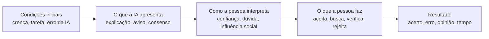

# Semana 09 - Trabalho 7: Dos resultados à teorização

**Disciplina:** Comunicação Científica - PPGI/UNIRIO
**Professor:** Sean Siqueira
**Tema:** Vieses cognitivos humanos em julgamentos mediados por LLMs, com atenção a sistemas multiagentes
**Versão:** v0.3 - texto simplificado para leitura, discussão e apresentação
**Base:** codificação da Semana 08 - 10 publicações (*reports*) e 13 investigações (*studies*)
**Repositório:** <https://github.com/andrecataldo/human-multi-llm-cognitive-bias-review>

> **Propósito deste trabalho:** apresentar o que os artigos mostram **em conjunto**, discutir esses resultados com apoio nas teorias estudadas e propor explicações que poderão ser investigadas no futuro. Não realizamos novas buscas nem acrescentamos estudos. Esta é uma síntese **preliminar**: ainda é necessário conferir integralmente os trechos extraídos e as medidas nos textos originais. Não reivindicamos validação independente, saturação teórica ou comprovação de uma nova teoria.

## 1. Resultados - O que encontramos na literatura?

Nossa pesquisa pergunta como sistemas baseados em LLMs podem influenciar o julgamento humano. A análise dos artigos sugere que essa influência não depende somente da resposta produzida pela IA. Também importam **o que a pessoa acreditava antes, como a resposta é apresentada, a possibilidade de verificar a informação e o contexto em que a decisão ocorre**.

Em vez de apresentar um tema por artigo, organizamos os achados em uma sequência:

**O que vem antes (antecedentes) → o que o sistema apresenta → como a pessoa reage → o que acontece com seu julgamento.**

O possível **mecanismo** é a explicação de *por que* uma relação ocorre (por exemplo, influência social ou interpretação de credibilidade). Nem todo estudo mediu esse mecanismo diretamente. Chamamos **condições contextuais** às circunstâncias que podem modificar a relação, como dificuldade da tarefa, crença prévia ou correção da resposta.

### 1.1. Crenças anteriores influenciam a busca por informações

Quando a pessoa já tem uma opinião, uma resposta do LLM que concorda com essa posição pode incentivar novas buscas que também reforçam essa visão. No estudo **FT1222 (ST011 e ST012)**, a busca conversacional e as respostas consonantes aumentaram consultas confirmatórias. Já apresentar conteúdo contrário **não reduziu esse comportamento de forma equivalente**.

**Relação encontrada:** crença anterior + resposta alinhada → maior tendência a procurar informação confirmatória, nas condições estudadas.

Esse é o resultado mais diretamente associado ao **viés de confirmação**, pois o estudo observou o comportamento de busca. Isso não significa que a opinião final da pessoa tenha mudado na mesma proporção.

### 1.2. Uma resposta convincente não é necessariamente uma resposta correta

Uma explicação detalhada pode tornar a resposta mais aceitável. Mas isso não significa que o usuário fique melhor em separar o certo do errado. Em **FT0070 (ST002)**, explicações aumentaram a aceitação de respostas corretas **e** incorretas. Em **FT0080 (ST005)**, intervenções para reduzir dependência excessiva da IA nem sempre melhoraram a escolha entre seguir uma resposta correta e rejeitar uma errada.

Em **FT0072 (ST003)**, a busca baseada em LLM tornou certas tarefas mais rápidas, mas produziu menor acurácia na tarefa particularmente vulnerável a erros do sistema. Esse estudo compara modalidades de busca; **não demonstra que a credibilidade percebida causou a queda de acurácia**.

**Relação encontrada:** forma de apresentar ou disponibilizar a resposta → mudança na aceitação ou no desempenho; **maior aceitação não garante melhor julgamento**.

### 1.3. Avisos de erro podem ajudar, mas dependem de como são apresentados

Alguns sinais fazem a pessoa considerar a possibilidade de a IA estar errada. Em **FT0070 (ST001 e ST002)**, fontes e inconsistências ajudaram participantes a questionar respostas ou a distinguir melhor determinadas respostas. Em **FT0072 (ST004)**, destacar baixa confiança incentivou novas consultas e aumentou a acurácia na tarefa analisada, embora tenha aumentado o tempo gasto.

Entretanto, não houve um efeito uniforme. Em **FT0080 (ST005)**, o destaque de incerteza não melhorou de maneira geral a dependência apropriada da IA. Em **FT1233 (ST013)**, a frase de incerteza em **primeira pessoa** reduziu a concordância com o sistema em comparação ao controle e elevou a acurácia; uma formulação genérica não teve a mesma diferença estatisticamente significativa.

**Relação encontrada:** apresentação de erros ou incertezas → pode alterar aceitação, consulta ou acurácia; **o efeito depende do tipo de aviso e da tarefa**.

Importante: **discordar mais da IA não é, por si só, verificar mais**. Apenas tratamos como verificação os comportamentos efetivamente observados, como novas consultas.

### 1.4. O conteúdo e o debate também podem mudar crenças e opiniões

Alguns artigos investigaram como argumentos ou narrativas produzidos por LLMs influenciam o posicionamento das pessoas:

- Em **FT0083 (ST006)**, debates com GPT-4 apresentaram efeitos persuasivos em comparações com debates entre humanos. Contudo, após a correção publicada em setembro de 2026, **não houve diferença estatisticamente significativa** na comparação direta entre GPT-4 personalizado e não personalizado (*p* = 0,0678, após correção).
- Em **FT0318 (ST008)**, diálogos com argumentos corretivos estiveram associados a uma redução da confiança em crenças conspiratórias e em outras crenças examinadas. As condições de rótulo AI/especialista e tom humano/neutro não apresentaram diferenças significativas nos resultados analisados.
- Em **FT0545 (ST009)**, diferentes formas de apresentar narrativas históricas geradas por LLMs se associaram a mudanças de opinião, dependendo do enquadramento do texto e do posicionamento anterior dos leitores.

**Relação encontrada:** conteúdo e formato de argumentos → podem influenciar opiniões e crenças, **mas mudar de opinião não prova, por si só, a existência de um viés cognitivo específico**.

### 1.5. Vários agentes podem aumentar a pressão social sem oferecer evidências independentes

Nos sistemas multiagentes, a pessoa pode receber respostas de diferentes agentes que concordam ou discordam. Em **FT0310 (ST007)**, condições com múltiplos agentes elevaram a **influência normativa** (pressão para acompanhar o grupo), mas não apresentaram aumento significativo correspondente da **influência informacional**. Os efeitos sobre opiniões não cresceram de maneira simples com a quantidade de agentes.

Em **FT0772 (ST010)**, participantes interpretaram sinais como maioria, consenso, crítica e divergência ao avaliar a confiabilidade das respostas. Esses relatos foram **qualitativos** e não demonstram, por si, que a decisão final tenha ficado mais correta.

**Relação encontrada:** apresentar mais agentes e concordância → pode criar sinais de influência social ou confiabilidade percebida; **isso não comprova que existam mais fontes de informação independentes**.

### 1.6. O que modifica essas relações?

Os resultados variam conforme as condições de cada estudo. Entre as condições mais relevantes estão a **crença inicial da pessoa**, a **correção da resposta**, a **dificuldade e o assunto da tarefa**, a **forma do aviso**, o **tempo necessário para verificar** e a **quantidade e apresentação dos agentes**. Essas condições ajudam a explicar por que uma intervenção pode ser útil em um experimento e não em outro. Nem todas foram testadas como moderadoras estatísticas nos artigos.

Também precisamos distinguir três coisas: **o que o usuário pensa da IA (percepção)**, **o que efetivamente faz (comportamento)** e **se toma uma boa decisão (desempenho)**. São medidas diferentes; uma não substitui a outra.

## 2. Discussão - Como interpretamos os resultados?

Nesta seção comparamos os resultados com as teorias selecionadas no **Trabalho 5**. A pergunta é: **o que encontramos é compatível com o que essas teorias sugerem? Quais limites e situações inesperadas aparecem?**

| Teoria ou abordagem | O que ela nos ajuda a entender | Nossa interpretação da literatura |
|---|---|---|
| **Judge–Advisor System (JAS)** - julgamento e aconselhamento | Como uma pessoa usa um conselho para manter ou revisar sua decisão. | **Compatível:** ST002 e ST005 mostram que a aceitação do conselho varia com as condições. Mas aceitar mais não significa decidir melhor. |
| **Trust in Automation** - confiança em automação | Por que confiança, uso de recomendações e desempenho precisam ser avaliados separadamente. | **Compatível, com limites:** explicações, fontes e incertezas podem mudar a aceitação, mas não garantem confiança bem calibrada (ST002, ST004, ST005, ST013). |
| **Social Influence** - influência social normativa e informacional | Como a presença de várias vozes pode afetar decisões. | **Compatível em parte:** ST007 encontrou maior influência normativa, sem aumento significativo correspondente da informacional. ST010 mostra como o consenso é interpretado. |
| **CASA** - computadores como atores sociais | Por que pessoas podem interpretar pistas de sistemas como sinais sociais. | **Interpretação plausível:** os resultados multiagentes são compatíveis com essa ideia, mas não a testam de forma conclusiva. |
| **Confirmation Bias / Biased Assimilation** | Como crenças prévias podem orientar a procura e a avaliação de informações. | **Apoio direto mais claro:** ST011 e ST012 identificaram mais consultas confirmatórias em condições específicas. Isso não permite generalizar para todas as mudanças de opinião. |
| **Anchoring-and-Adjustment** - ancoragem | Como uma referência inicial pode influenciar julgamentos posteriores. | **Sem teste direto no corpus codificado:** não podemos dizer que a teoria foi confirmada ou refutada. |
| **Automation Bias / Complacency** | Quando a dependência da automação pode prejudicar a avaliação humana. | **Possível explicação**, mas *overreliance* não é automaticamente uma medida de *automation bias*. Não identificamos operacionalização direta suficiente do construto no corpus. |

### 2.1. Em que os artigos convergem?

Três ideias aparecem como especialmente importantes: **(1)** sinais de apresentação afetam a relação do usuário com a resposta; **(2)** a crença prévia pode orientar a busca de informações; **(3)** múltiplos agentes podem produzir influência social. Cada afirmação tem alcance delimitado pelas tarefas e medidas de seus estudos.

### 2.2. O que encontramos de inesperado?

Há três contrastes interessantes:

1. **Mais explicação não garante mais acerto.** Explicações podem aumentar a aceitação de respostas erradas (ST002).
2. **Mostrar incerteza nem sempre ajuda da mesma forma.** O resultado muda conforme linguagem, tarefa e medida (ST005 e ST013). Esses estudos não testaram exatamente a mesma intervenção.
3. **Mais agentes não significa necessariamente mais informação.** Houve influência normativa sem aumento significativo correspondente da influência informacional (ST007).

Esses resultados **não refutam as teorias completas**. Eles mostram que uma leitura simplificada delas - como “mais explicação sempre ajuda” ou “mais agentes sempre melhoram a decisão” - seria inadequada.

### 2.3. O que ainda não sabemos?

Dentro **destas dez publicações**, faltam evidências diretas suficientes sobre: **ancoragem humana**, *automation bias* especificamente operacionalizado, efeitos da **independência real entre agentes** e os processos psicológicos que ligam uma pista apresentada pela IA ao comportamento observado. Essas são **lacunas do conjunto analisado**, não afirmações de que ninguém estudou os temas em toda a literatura.

## 3. Teorização - O que podemos propor a partir desses resultados?

A síntese sugere uma explicação geral:

> **A influência de um LLM no julgamento humano depende não só da qualidade da resposta, mas também de como a pessoa interpreta os sinais apresentados e das oportunidades que tem de conferir a informação.**

Em um sistema com vários agentes, aparece uma questão adicional: **ver várias respostas concordantes pode dar a impressão de confirmação, mesmo sem sabermos se as respostas vêm de fontes realmente independentes**.

Chamamos provisoriamente essa possível interpretação de **“corroboração aparente”**: a pessoa *poderia* tomar o acordo entre agentes como se fosse confirmação independente. **Isso ainda não foi diretamente demonstrado pelos estudos codificados**, e o termo não é apresentado como conceito inédito ou teoria validada.

### 3.1. Modelo conceitual simples

O diagrama é **uma organização interpretativa da revisão**, e não uma cadeia causal já comprovada. O tipo de tarefa, as crenças anteriores, o custo de checagem e a configuração dos agentes podem alterar as relações.

### 3.2. Cinco proposições para pesquisas futuras

**P1 - Explicação e aceitação.** Apresentar uma explicação pode aumentar a aceitação da resposta, inclusive quando ela está errada. **Como testar:** comparar aceitação de respostas corretas e incorretas, com e sem explicação. *Inspirada em ST002 e ST005.*

**P2 - Avisos e verificação.** Um sinal de possível erro pode ajudar mais quando a pessoa dispõe de uma maneira simples de conferir a informação. **Como testar:** variar o aviso e o esforço necessário para verificar, medindo ações reais de consulta e acurácia. *Inspirada em ST001, ST002, ST004, ST005 e ST013; a moderação pelo custo ainda não está demonstrada.*

**P3 - Crença prévia e busca.** Uma resposta que concorda com a crença anterior pode incentivar mais buscas confirmatórias; uma resposta contrária não necessariamente produz efeito inverso equivalente. **Como testar:** variar concordância e discordância e observar o histórico de consultas. *Inspirada em ST011 e ST012.*

**P4 - Pluralidade e influência social.** Mostrar vários agentes concordando pode aumentar influência normativa sem necessariamente aumentar o valor informacional da resposta. **Como testar:** variar número de agentes, grau de acordo e qualidade das evidências. *Inspirada em ST007 e ST010.*

**P5 - Corroboração aparente.** Quando a pessoa interpreta consenso como confirmação independente, ela **pode** confiar mais do que a qualidade das evidências justificaria. **Como testar:** comparar agentes realmente independentes com agentes que compartilham fontes, medir o que o usuário acredita sobre essa independência e observar suas decisões. *É hipótese nova da nossa síntese, ainda sem teste direto no corpus.*

### 3.3. Qual é a contribuição desta etapa?

O trabalho **não criou nem validou uma teoria nova**. Ele organizou descobertas de vários estudos em uma explicação comum, identificou limites das teorias usadas e formulou proposições que poderão orientar futuros experimentos - principalmente na comparação entre interações com um LLM e com múltiplos agentes.

## 4. De quais artigos vieram essas afirmações?

A tabela abaixo funciona como registro de **rastreabilidade**. Mantemos os identificadores utilizados na codificação e o acesso às fontes originais; o corpo do texto prioriza as relações, não a contagem dos artigos.

| Publicação | Estudos | Contribuição utilizada nesta síntese | Fonte |
|---|---|---|---|
| **FT0070** | ST001, ST002 | Explicações, fontes, inconsistências, aceitação e verificação. | [Artigo](https://doi.org/10.1145/3706598.3714020) |
| **FT0072** | ST003, ST004 | Busca LLM, tempo, acurácia e avisos de baixa confiança. | [Artigo](https://doi.org/10.1145/3706598.3714082) |
| **FT0080** | ST005 | Intervenções para uso apropriado do conselho do LLM. | [Artigo](https://arxiv.org/html/2412.15584v3) |
| **FT0083** | ST006 | Persuasão em debate; interpretação ajustada à correção de 2026. | [Artigo](https://doi.org/10.1038/s41562-025-02194-6) · [Correção](https://doi.org/10.1038/s41562-026-02588-0) |
| **FT0310** | ST007 | Influência normativa e informacional em grupos de agentes. | [Artigo](https://doi.org/10.1145/3757633) |
| **FT0318** | ST008 | Mudança de confiança em crenças após diálogos corretivos. | [Artigo](https://doi.org/10.1093/pnasnexus/pgaf325) |
| **FT0545** | ST009 | Enquadramento de narrativas históricas e opinião. | [Artigo](https://doi.org/10.1093/pnasnexus/pgag022) |
| **FT0772** | ST010 | Como participantes interpretam consenso, crítica e divergência em interfaces multiagentes. | [Artigo](https://doi.org/10.1145/3772318.3791157) |
| **FT1222** | ST011, ST012 | Busca confirmatória e alinhamento com crença anterior. | [Artigo](https://doi.org/10.1145/3613904.3642459) |
| **FT1233** | ST013 | Formulações de incerteza, concordância e acurácia. | [Artigo](https://facctconference.org/static/papers24/facct24-56.pdf) |

Para o detalhamento dos métodos, medidas, condições e observações de cada estudo, consultar a codificação da Semana 08 em `docs/trabalho-6/codificacao-completa-10-reports-v0.1.md` e a matriz `data/included/codificacao-semana-08-13-studies-v0.1.csv`.

## 5. Limitações e próximos passos

Esta análise utiliza **dez publicações da seleção inicial**, não toda a literatura recuperada no mapeamento. Os estudos têm tarefas, participantes e medidas diferentes; portanto, **não calculamos um efeito médio nem podemos afirmar que um resultado vale para todos os sistemas LLM**. A codificação foi assistida por IA e a conferência humana sistemática dos excertos nas fontes primárias permanece pendente.

Antes de desenvolver a teorização em profundidade, será necessário: verificar os trechos e comparadores originais; avaliar se conceitos como “corroboração aparente” já estão descritos em outras teorias; procurar resultados contrários; e desenhar estudos que distingam percepção, comportamento e desempenho, especialmente em sistemas multiagentes.

## 6. Conclusão

**Nosso principal aprendizado é que a aparência de confiabilidade de uma resposta não garante que ela ajude a tomar uma decisão melhor.** O resultado depende do que o usuário já acreditava, da qualidade da informação, da forma de apresentação e das chances reais de verificação. Em sistemas multiagentes, concordância entre agentes também pode funcionar como um sinal social, sem demonstrar confirmação independente da informação.

A contribuição da Semana 09 é passar **da lista de temas para relações entre resultados**, **das relações para uma discussão apoiada em teorias** e, por fim, **da discussão para hipóteses testáveis**. Essas hipóteses permanecem provisórias.

---

### Base metodológica e continuidade

- Kitchenham, B.; Charters, S. (2007). *Guidelines for performing Systematic Literature Reviews in Software Engineering* - orientação geral para síntese e reporte de estudos primários.
- Wolfswinkel, J. F.; Furtmueller, E.; Wilderom, C. P. M. (2011). *Using grounded theory as a method for rigorously reviewing literature* - inspiração para comparação e integração de códigos.
- Leidner, D. E.; Tona, O. (2021). *A Thought-Gear Model of Theorizing from Literature* - orientação para o movimento da análise da literatura para proposições conceituais.
- **Trabalho 5** - `docs/trabalho-5/trabalho-5-teoria-e-rtd-v0.2.md`: definição das lentes teóricas usadas.
- **Trabalho 6** - `docs/trabalho-6/codificacao-completa-10-reports-v0.1.md`: evidências de partida para esta síntese.

**Nota de método:** a organização em antecedentes, sinais, mecanismos, comportamentos, resultados e condições é uma **decisão analítica desta pesquisa**, não uma regra atribuída a SEGRESS. A utilização das técnicas de codificação e teorização não caracteriza uma Grounded Theory completa nem comprova saturação.