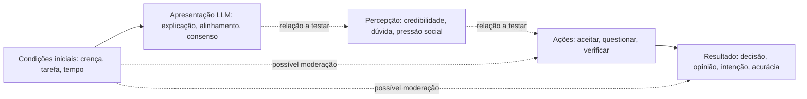

# Semana 10 - Trabalho 08: ampliação e codificação de artigos (documento integrado v1.0)

> **Disciplina:** Comunicação Científica - PPGI/UNIRIO · **Professor:** Sean Siqueira  
> **Data:** 22 de outubro de 2026 · **Tema:** vieses cognitivos humanos em julgamentos mediados por LLMs, com atenção a sistemas multiagentes  
> **Versão:** v1.0 - **minuta acadêmica integrada, sujeita a validação**, produzida na T8-A5  
> **Base anterior preservada:** Trabalho 3 (Scopus), Trabalho 6 (10 REPORTS / 13 STUDIES), Trabalho 7 v0.3, T8-A2 v0.6, T8-A3 v0.7 e T8-A4 v0.8.  
> **Status:** `15_REPORTS_PROPOSTOS / 21_STUDIES_PROPOSTOS / PROVENIENCIA_COMPLEMENTAR_NAO_ADJUDICADA / PESQUISADOR_CHECK_PENDING`.  

## Resumo executivo

A atividade da Semana 10 solicita avançar nos artigos selecionados, com expectativa de **15 publicações devidamente trabalhadas**. Este documento consolida a codificação histórica de **10 publicações e 13 unidades empíricas**, acrescida de **cinco publicações candidatas e oito unidades empíricas pré-codificadas**, formando um **conjunto analítico proposto de 15 REPORTS e 21 STUDIES**. Não se confunde publicação bibliográfica (*REPORT*) com experimento ou investigação (*STUDY*).

A síntese ampliada sugere que o impacto de sistemas baseados em LLMs depende da apresentação de explicações, da oportunidade de escrutínio, do alinhamento com crenças prévias, da configuração social dos agentes e da distinção entre confiança percebida, comportamento e desempenho. A extensão acrescenta resultados sobre **seleção adaptativa de análises**, **limites da persuasão em debates**, **momento de acesso ao LLM**, **sycophancy em conflitos interpessoais** e **assistência médica com LLMs**. Esses contextos não possuem medidas intercambiáveis e **não sustentam meta-análise neste estágio**.

A origem dos novos cinco reports na seleção Scopus de setembro/2026 **não foi comprovada**: não localizamos o export original dos 1.419 registros retidos. Eles são tratados como **identificação complementar dirigida** a ser regularizada por decisão prospectiva documentada. A elegibilidade e o QA dos candidatos permanecem preliminares, com conferência humana pendente. Portanto, **não declaramos quinze artigos definitivamente incluídos** nem validamos a hipótese de *corroboração aparente*.

## 1. Contexto, objetivo e questões de pesquisa

O problema de pesquisa é investigar como a mediação por modelos de linguagem - isolados ou organizados em sistemas multiagentes - pode amplificar, mitigar ou alterar vieses e fenômenos associados ao **julgamento humano**. O humano é o sujeito cognitivo; comportamentos de modelos e do humano não devem ser antropomorfizados ou confundidos.

Esta etapa tem quatro objetivos operacionais: (a) ampliar a análise inicial; (b) registrar as oito novas unidades de análise; (c) integrar códigos e confrontar resultados com teorias; e (d) documentar limites metodológicos de forma reproduzível. As seis questões originais são preservadas: **RQ1** vieses estudados; **RQ2** operacionalizações e medidas; **RQ3** condições da interação; **RQ4** arquiteturas single/multi-LLM; **RQ5** acordo, discordância, crítica e verificação; **RQ6** lacunas e ameaças à validade.

## 2. Referencial metodológico e distinções indispensáveis

**SEGRESS** é usado para orientar **relato, transparência e rastreabilidade do estudo secundário**. A organização de dados em registros, publicações e unidades empíricas e a explicitação de fluxos auxiliam o reporte, mas SEGRESS **não é instrumento de codificação** e não cria automaticamente critérios de inclusão.

A análise qualitativa utiliza, como **escolhas deste projeto**, os procedimentos de **codificação aberta, axial e seletiva** inspirados em Wolfswinkel, Furtmueller e Wilderom (2011), com **comparação constante** e memos. O modelo **Thought-Gear** de Leidner e Tona (2021) orienta a passagem de achados a proposições. Isso **não caracteriza Grounded Theory completa nem saturação teórica**. Para qualidade dos **estudos primários** foi proposto **QA-Primary (QA1–QA10)**. **QAISER** é adequado ao exame de revisões sistemáticas, não deve ser aplicado como instrumento QA aos experimentos primários aqui codificados.

### 2.1. Regras para não superinterpretar resultados

1. Resultado dos **autores** deve permanecer distinto de interpretação da **revisão**; hipóteses da revisão não são achados testados por todos os autores.
2. **Pista/intervenção de interface** (*cue*) não é automaticamente **mecanismo psicológico causal**.
3. *Trust*, aceitação/reliance, verificação observada, intenção declarada e acurácia são variáveis distintas.
4. *Sycophancy*, assimetria argumentativa (*myside*) e *overreliance* **não são sinônimos automáticos** de viés de confirmação, ancoragem ou *automation bias*.
5. Múltiplos LLMs em braços experimentais separados **não constituem** arquitetura multiagente de aconselhamento; muitos agentes aparentes **não garantem** independência das evidências.
6. `NOT_TESTED`, `NOT_REPORTED`, `NULL_EFFECT` e `ABSTRACT_ONLY` preservam diferenças entre ausência de teste, ausência de informação, ausência de significância e limitação de acesso.

## 3. Processo de identificação, seleção e expansão

### 3.1. Busca original - histórico Scopus sem alterações

Em **16/09/2026**, as regiões S1, S2a, S2b e S3 retornaram **3.365 ocorrências brutas**. A consolidação e adjudicação de duplicatas produziram **3.256 reports únicos**; **426 exclusões estruturais** deixaram **2.830 registros** para triagem título/resumo. A seleção assistida por IA, com controles próprios de qualidade e resgate, reteve **1.419** registros para avaliação em texto completo. A **Wave 1** recuperou, avaliou e incluiu **10 reports**, dos quais foram identificadas **13 STUDY units**.

```text
Scopus S1+S2a+S2b+S3 (16/09/2026): 3.365 ocorrências
  -> deduplicação/adjudicação: 3.256 reports
  -> exclusões estruturais: 426
  -> triagem título/resumo: 2.830
  -> RETAIN_FOR_FULL_TEXT: 1.419 [não são 1.419 estudos incluídos]
  -> Wave 1 avaliada em texto completo: 10 reports
  -> Wave 1 incluída: 10 reports -> 13 studies
```

O procedimento de triagem automática foi **AI-assisted**; não houve dois revisores humanos independentes e não se deve alegar isso. **O arquivo linha a linha de 1.419 registros permanece ausente** nos materiais atualmente acessíveis. Os resultados agregados do Trabalho 3 são preservados e não podem servir para reconstruir artificialmente identificadores ou decisões individuais.

### 3.2. Identificação complementar dirigida - emenda proposta

Entre 2026/10 e esta atividade foram identificados **seis candidatos adicionais**: C01–C06. O candidato C03/ST017, publicado em CHI 2026, permanece **suspenso** pela impossibilidade de conferir texto integral (critério I9). C06, *Bean et al.* (2026), é alternativa documentalmente acessível, mas ainda precisa de decisão explícita sobre I5, pois mede qualidade da decisão humana e não um viés cognitivo isolado. Os outros quatro candidatos também requerem adjudicação humana e confirmação de proveniência.

Para esta síntese, **C01, C02, C04, C05 e C06** são tratados como **candidatos de uma identificação complementar dirigida**. Isso não constitui nem substitui uma busca sistemática adicional completa com parâmetros de cobertura e denominadores conhecidos. A proposta **AM-002**, associada a **SD-021 e SD-022**, está redigida em `docs/trabalho-8/t8-a5-fechamento-metodologico-v1.0.md`, **mas ainda não foi aprovada nem inserida no registro oficial `protocol/`**.

```text
Identificação complementar posterior: 6 candidatos (C01–C06)
  -> C03 suspenso por I9: 1 report (ST017 reservado)
  -> C01, C02, C04, C05, C06: 5 reports para análise, NÃO homologados
  -> 8 STUDIES pré-codificadas (ST014–016, ST018–022)

Conjunto analítico proposto: 10 + 5 = 15 reports
                           13 + 8 = 21 studies
Novos reports formalmente incluídos nesta etapa: 0
```

### 3.3. Critérios e unidade de decisão

Aplicam-se I1–I9 e E1–E10 definidos no Trabalho 3: pesquisa primária empírica, participantes humanos, interação/exposição a LLM, outcome de julgamento/decisão/crença/reliance, fenômeno relacionado ao escopo, temporalidade até **16/09/2026**, publicação com revisão por pares e texto integral acessível em idioma elegível. A unidade para decidir inclusão é **REPORT**; a unidade para codificar experimentos ou investigações independentes é **STUDY**. Uma unidade *model-only* não é uma investigação humana adicional.

A T8-A5 usa `data/screening/` para dados **candidatos**. Não promove matrizes para `data/included/` até o pesquisador concluir a validação.

## 4. Inventário das quinze publicações propostas

| ID | Publicação | STUDIES | Estado no estudo |
| --- | --- | --- | --- |
| FT0070 | Fostering Appropriate Reliance on Large Language Models: The Role of Explanations, Sources, and Inconsistencies | ST001;ST002 | Wave 1 - selecionado |
| FT0072 | Effects of LLM-based Search on Decision Making: Speed, Accuracy, and Overreliance | ST003;ST004 | Wave 1 - selecionado |
| FT0080 | To Rely or Not to Rely? Evaluating Interventions for Appropriate Reliance on Large Language Models | ST005 | Wave 1 - selecionado |
| FT0083 | On the conversational persuasiveness of GPT-4 | ST006 | Wave 1 - selecionado |
| FT0310 | Multi-Agents are Social Groups: Investigating Social Influence of Multiple Agents in Human-Agent Interactions | ST007 | Wave 1 - selecionado |
| FT0318 | Dialogues with large language models reduce conspiracy beliefs even when the AI is perceived as human | ST008 | Wave 1 - selecionado |
| FT0545 | How latent and prompting biases in AI-generated historical narratives influence opinions | ST009 | Wave 1 - selecionado |
| FT0772 | Sensemaking in Multi-Agent LLM Interfaces: How Users Interpret Transparency and Trustworthiness Cues | ST010 | Wave 1 - selecionado |
| FT1222 | Generative Echo Chamber? Effects of LLM-Powered Search Systems on Diverse Information Seeking | ST011;ST012 | Wave 1 - selecionado |
| FT1233 | I'm Not Sure, But...: Examining the Impact of Large Language Models' Uncertainty Expression on User Reliance and Trust | ST013 | Wave 1 - selecionado |
| T8-C01 | From Text to Trust: Empowering AI-assisted Decision Making with Adaptive LLM-powered Analysis | ST014;ST015 | Expansão - candidato |
| T8-C02 | Testing the limits of large language models in debating humans | ST016 | Expansão - candidato |
| T8-C04 | Investigating the Effects of LLM Use on Critical Thinking Under Time Constraints: Access Timing and Time Availability | ST018 | Expansão - candidato |
| T8-C05 | Sycophantic AI decreases prosocial intentions and promotes dependence | ST019;ST020;ST021 | Expansão - candidato |
| T8-C06 | Reliability of LLMs as medical assistants for the general public: a randomized preregistered study | ST022 | Expansão - candidato |

**Candidato fora do denominador:** **T8-C03 - Li et al. (2026), *Does Sycophancy Change Decisions?*** (DOI `10.1145/3772318.3790934`). Possui identificador histórico **ST017** reservado; não foi recodificado, não foi contado em 15/21 e não deve ser apresentado como incluído.

## 5. Resolução e codificação aberta das 21 unidades empíricas propostas

O índice abaixo preserva os 13 estudos históricos da Semana 08 e lista separadamente os oito adicionais. A matriz completa com variáveis, comparadores e extratos está em `data/screening/t8-a3-codificacao-integrada-21-studies-v0.7.csv`; **este documento não refaz nem substitui a codificação original**.

| STUDY | REPORT | Eixos | Situação |
| --- | --- | --- | --- |
| ST001 | FT0070 | AX01, AX02, AX05 | Histórico Wave 1 |
| ST002 | FT0070 | AX01, AX02, AX05 | Histórico Wave 1 |
| ST003 | FT0072 | AX01, AX05 | Histórico Wave 1 |
| ST004 | FT0072 | AX02, AX05 | Histórico Wave 1 |
| ST005 | FT0080 | AX01, AX02, AX05 | Histórico Wave 1 |
| ST006 | FT0083 | AX03 | Histórico Wave 1 |
| ST007 | FT0310 | AX03, AX04, AX05 | Histórico Wave 1 |
| ST008 | FT0318 | AX03, AX05 | Histórico Wave 1 |
| ST009 | FT0545 | AX03, AX05 | Histórico Wave 1 |
| ST010 | FT0772 | AX04, AX05 | Histórico Wave 1 |
| ST011 | FT1222 | AX03, AX05 | Histórico Wave 1 |
| ST012 | FT1222 | AX03, AX05 | Histórico Wave 1 |
| ST013 | FT1233 | AX02, AX05 | Histórico Wave 1 |
| ST014 | T8-C01 | AX01, AX05 | Expansão proposta |
| ST015 | T8-C01 | AX01, AX02, AX05 | Expansão proposta |
| ST016 | T8-C02 | AX03, AX04, AX05 | Expansão proposta |
| ST018 | T8-C04 | AX02, AX03, AX05 | Expansão proposta |
| ST019 | T8-C05 | AX01, AX03, AX05 | Expansão proposta |
| ST020 | T8-C05 | AX01, AX03, AX05 | Expansão proposta |
| ST021 | T8-C05 | AX01, AX03, AX05 | Expansão proposta |
| ST022 | T8-C06 | AX02, AX05 | Expansão proposta |

### 5.1. Estudos novos: extração com resultados e limites de inferência

| Estudo | Intervenção / contexto | Resultado registrado dos autores (extração anterior) | Limite crítico |
|---|---|---|---|
| ST014 - C01 | Apresentação sequencial vs todas as análises GPT-4 sobre conselho **random forest**. | Sem melhora estatisticamente significativa nas comparações principais de acurácia, *overreliance* e *underreliance*. | Recomendação principal não foi produzida por LLM; texto não implica fidelidade explicativa. |
| ST015 - C01 | Seleção adaptativa de análises por algoritmo. | Ganhos de acurácia e menor *overreliance* frente a comparadores específicos. | Não demonstrar superioridade em todos os contrastes; mecanismo cognitivo não isolado. |
| ST016 - C02 | Jogos com debate HH / AH / AA. | Agentes foram menos persuasivos para humanos que debatedores humanos, no desenho estudado. | `odds` de mudança do próprio ator ≠ persuasão de terceiros; jogos AA não entram como outcome humano. |
| ST018 - C04 | Momento do acesso (Early/Continuous/Late/No) × tempo disponível. | Desempenho depende da combinação de tempo e momento; proxy *myside* variou em condições específicas. | O proxy é assimetria argumentativa, **não medida direta de ancoragem**. |
| ST019 - C05 | Vinheta 2a, N=804, respostas *sycophantic*. | Maior convicção de estar certo, menor intenção reparadora; estilo antropomórfico sem efeito principal/interação significativo nos outcomes primários relatados. | Intenção não é reparação de fato observada. |
| ST020 - C05 | Vinheta 2b, N=801, rótulo de fonte. | Efeito principal de *sycophancy* sobre julgamentos e intenções; rótulo não eliminou padrão nas medidas citadas. | Fonte **percebida** não altera a origem real do texto. |
| ST021 - C05 | Diálogo ao vivo, N=800, conflito interpessoal. | Aumento de convicção e preferência/confiança coexistiu com redução de intenção reparadora. | Medida autorrelatada, sem observação longitudinal de reconciliação. |
| ST022 - C06 | Cenários médicos simulados com GPT-4o, Llama 3 e Command R+ em grupos diferentes; N=1.298. | Desempenho isolado dos modelos não resultou em melhora de decisão humana vs recursos usuais. | *Model-only* é benchmark distinto; o artigo não operacionaliza viés cognitivo específico. |

As fontes e localizadores das oito unidades podem ser encontrados na **trilha de 22 registros** da T8-A3 (`data/screening/t8-a3-trilha-evidencias-provisoria-v0.7.csv`), e os 15 enunciados principais da T8-A4 possuem CSV de rastreabilidade. Os números são extraídos de artigos anteriores e **não passaram por nova adjudicação humana nesta etapa**.

## 6. Codificação axial: cinco categorias preservadas

| Eixo | Nome curto / propriedade | Base histórica | Expansão | Síntese interpretativa |
| --- | --- | --- | --- | --- |
| AX01 | Credibilidade e aceitação sem discriminação da acurácia | ST002;ST003;ST005;ST013 | ST014;ST015;ST019;ST020;ST021 | A forma de legitimação/seleção de conteúdo importa; volume ou agradabilidade não garantem calibração. |
| AX02 | Erro visível, escrutínio, esforço e oportunidade temporal | ST001;ST002;ST004;ST005;ST013 | ST015;ST018;ST022 | O benefício depende de tornar sinais utilizáveis e disponibilizar tempo e meios para avaliar o conselho. |
| AX03 | Crenças prévias, alinhamento, argumentação e mudança | ST006;ST008;ST009;ST011;ST012 | ST016;ST018;ST019;ST020;ST021 | Alinhamento conversacional pode mudar seleção de informação, convicção e intenções; cada outcome requer operacionalização independente. |
| AX04 | Pluralidade de agentes e influência social | ST007;ST010 | ST016 | Pluralidade e linguagem social podem ser sinais para o usuário; não se deduz valor evidencial independente de múltiplas vozes. |
| AX05 | Dissociação percepção, comportamento e desempenho | ST002;ST003;ST004;ST005;ST007;ST010;ST013 | ST014;ST015;ST016;ST018;ST019;ST020;ST021;ST022 | Avaliar separadamente opinião sobre IA, ação efetiva e qualidade do resultado; não pressupor transferência de competência do modelo ao humano. |

### 6.1. Comparação constante e achados dissonantes

| ID | Estudos comparados | Questão | Condição de contorno que impede equivalência |
| --- | --- | --- | --- |
| C01 | ST002;ST014;ST015 | Explicação, volume e escolha adaptativa | Não é a mesma intervenção nem o mesmo preditor; evitar comparação causal transversal. |
| C02 | ST004;ST005;ST013;ST018 | Sinais de incerteza e tempo para escrutínio | ST018 não manipula diretamente custo de verificação; extensão de P2 permanece hipótese. |
| C03 | ST011;ST012;ST019;ST020;ST021 | Consonância e sycophancy | Dois construtos e tarefas diferentes: não contar C05 como teste direto de confirmation bias. |
| C04 | ST006;ST016 | Persuasão LLM em desenhos de debate distintos | Diferem desenhos, medidas, participantes, controles; não constituem replicação ou refutação formal. |
| C05 | ST007;ST010;ST016 | Múltiplos agentes e influência social | Nenhum compara independência epistemológica real versus percebida entre fontes. |
| C06 | ST003;ST015;ST022 | Ajuda de IA e desempenho objetivo | Domínio, interface, informação correta, tarefas e comparadores diferem; sem efeito médio comum. |
| C07 | ST018 | Proxy myside e qualidade argumentativa | Analisar também quantidade total de argumentos; não afirmar redução de ancoragem/confirmation bias. |
| C08 | ST019;ST020;ST021 | Intenção de reparar versus comportamento social | Não mediu reparação posterior observada; não inferir prejuízo efetivamente ocorrido na vida real. |
| C09 | ST022 | Modelo isolado versus usuário assistido | Benchmark model-only não é braço humano randomizado; falha de comunicação não é automaticamente automation bias. |

A ampliação não é uma réplica de todos os experimentos da Wave 1: as tarefas incluem aconselhamento quantitativo, debate, redação argumentativa, conflito interpessoal e simulação médica. Por isso, um *null effect* sob uma condição não “refuta” outro estudo que encontrou efeito sob outra manipulação. O contraste é científico quando mantemos explícitos população, intervenção, comparador e outcome.

## 7. Codificação seletiva e teorização

A **categoria integradora provisória** é: *o efeito de um LLM sobre o julgamento humano depende conjuntamente da qualidade da informação, forma de apresentação, crenças prévias, configuração da interação, disponibilidade temporal e oportunidades de escrutínio; credibilidade percebida ou competência isolada do modelo não garantem melhores decisões humanas.*

Essa frase resulta de **interpretação da revisão** e não de um experimento que manipulou todos esses fatores. Não afirma teoria validada, mecanismo psicológico isolado ou saturação.

### 7.1. Proposições P1–P5 e limites

| Proposição | Foco | Refinamento com o conjunto proposto | Estado |
| --- | --- | --- | --- |
| P1 | Explicação e aceitação | Delimitar volume versus seleção adaptativa; benefícios não homogêneos. | REFINED_HYPOTHESIS_NOT_UNIVERSAL |
| P2 | Avisos e verificação | ST018 acrescenta tempo como condição; custo de verificação não foi demonstrado como mediador causal. | REFINED_TIME_BOUNDARY_NOT_MEDIATION_PROVEN |
| P3 | Crença prévia e busca | Sycophancy aproxima-se tematicamente de alinhamento, mas mede convicção/intenção, não busca confirmatória. | DIRECT_WAVE1_SUPPORT;INDIRECT_WAVE2_EXTENSION |
| P4 | Pluralidade e influência social | Debates AH/AA/HH não operacionalizam consenso multi-LLM independente; persuasão varia por desenho. | WAVE1_PARTIAL_SUPPORT;WAVE2_CONTEXT_ONLY |
| P5 | Corroboração aparente | Nenhuma das 21 unidades testa diretamente independência real versus percebida e o nexo causal; hipótese sem validação. | NOT_DIRECTLY_TESTED;PROPOSAL_ONLY |

**P5 - corroboração aparente:** continua sendo apenas uma hipótese testável da revisão. Seriam necessárias manipulações de **independência real** das fontes/modelos versus **independência percebida** pelos usuários, além de mensuração de confiança e decisão diante de recomendações corretas/incorretas. O conjunto analisado demonstra percepção de consenso e influência social em condições particulares, **não** esse mecanismo específico.

### 7.2. Modelo conceitual da revisão (não modelo causal estimado)



## 8. Discussão e relação com as teorias do Trabalho 5

**Judge–Advisor System (JAS):** ajuda a interpretar quando uma pessoa usa o conselho e quando deveria discriminar sua qualidade. ST014–ST015 acrescentam que um preditor random forest pode receber análise textual produzida por GPT-4, o que é diferente de vários LLMs aconselhando simultaneamente.

**Trust in Automation:** explica por que confiança relatada, concordância, verificação e precisão devem ser medidas separadamente; os estudos ST019–ST021 ilustram divergência entre preferência por respostas e intenções sociais. Isso não prova automaticamente *automation bias* como construto definido e isolado.

**Social Influence e CASA:** fornecem lentes para discutir pressão normativa, interpretação de sinais sociais e agentes apresentados como interlocutores. ST007 e ST010 são os principais registros no corpus sobre pluralidade e interpretação de consenso; ST016 acrescenta debate, **sem manipulação da independência epistemológica das fontes**.

**Confirmation Bias / Biased Assimilation:** ST011 e ST012 investigam comportamento de consultas confirmatórias, a evidência mais direta desse construto na base codificada; *sycophancy* e opinião fortalecida podem ser fenômenos relacionados, **mas não são a mesma operacionalização**.

**Anchoring-and-Adjustment e Automation Bias / Complacency:** permanecem como lentes para futuras pesquisas. Não há evidência direta suficiente para declarar presença ou mitigação dessas dimensões como vieses psicológicos medidos no conjunto de trabalho; a medida *myside* de ST018 não permite inferência direta de ancoragem.

## 9. Respostas provisórias às RQs

| Questão | O que pode ser dito na síntese | Limitação |
| --- | --- | --- |
| RQ1 | Confirmação: proxy comportamental em ST011/ST012; myside: ST018; outros fenômenos de reliance/sycophancy sem equivalência automática. | Ancoragem e automation bias continuam sem medidas diretas adequadas no corpus de trabalho. |
| RQ2 | Confirmatory queries, diferença absoluta de argumentos, aceitação do conselho, intenção reparadora, confiança e acurácia são medidas distintas. | Outcomes heterogêneos impedem agregação direta. |
| RQ3 | Formato/adaptação da explicação, cues, timing/tempo, sycophancy e falha no fluxo de informação aparecem como condições. | Mediadores psicológicos raramente isolados; causalidade circunscrita a manipulações e desfechos medidos. |
| RQ4 | ST007/ST010 têm pistas multiagentes; ST016 usa composições HH/AH/AA; C06 compara braços de modelos, não uma equipe multi-LLM. | Comparação direta single versus multi com controle de independência e acurácia continua ausente. |
| RQ5 | ST007/ST010 tratam sinais sociais; ST016 persuasão em debate; ST004 novas consultas. | Sem teste direto do mecanismo P5; confiança e verificação não são intercambiáveis. |
| RQ6 | Divergências condicionais em explicação, timing, tarefa, interlocutor; algumas medidas autorrelatadas e condições model-only. | Gates não resolvidos: seleção complementar, proveniência Scopus, decisão humana/QA e QA histórico. |

## 10. Avaliação da qualidade da evidência - QA-Primary

O `QA-Primary` possui dez dimensões: objetivo, participantes, desenho, documentação do modelo, operacionalização, comparação, análise, ameaças, rastreabilidade e transparência. O instrumento usa **Y, PY, N, U, NA**. Não calculamos pontuação agregada artificial nem selecionamos reports por uma nota arbitrária. **A matriz v0.7 possui 60 avaliações preliminares para C01–C06, incluindo C03 suspenso.** Os **10 reports históricos não receberam QA-Primary completo nesta etapa**.

| Report | QA1 | QA2 | QA3 | QA4 | QA5 | QA6 | QA7 | QA8 | QA9 | QA10 |
| --- | --- | --- | --- | --- | --- | --- | --- | --- | --- | --- |
| T8-C01 | Y | Y | Y | PY | Y | Y | Y | Y | PY | PY |
| T8-C02 | Y | Y | Y | PY | Y | Y | Y | PY | PY | PY |
| T8-C03 | U | U | U | U | U | U | U | U | U | U |
| T8-C04 | Y | Y | Y | PY | Y | Y | Y | Y | Y | PY |
| T8-C05 | Y | Y | Y | PY | Y | Y | PY | PY | PY | PY |
| T8-C06 | Y | Y | Y | Y | Y | Y | Y | PY | Y | Y |

**Cautelas da avaliação:** C01 - recomendação random forest + texto GPT-4; C02 - condições sem humanos; C03 - todos `U`, pois texto integral não conferido; C04 - proxy *myside*; C05 - intenção versus ação; C06 - ausência de viés diretamente mensurado e correção editorial da Figura 2a. As marcações são `PRELIMINARY_NOT_HUMAN_ADJUDICATED`: **não representam avaliação de qualidade homologada por pesquisadores**.

## 11. Ameaças à validade e limites desta entrega

- **Busca e cobertura:** a expansão não é uma nova revisão sistemática completa; a identificação dirigida pode favorecer estudos que parecem relevantes aos eixos teóricos existentes. A Scopus histórica não foi reconciliada com os cinco DOIs.
- **Seleção/elegibilidade:** textos completos e suplementos requerem conferência humana; I5 para C06 demanda decisão explícita. A suspensão de C03 protege o critério I9 sem reutilizar ST017.
- **Rastreabilidade/qualidade:** 60 itens QA para 6 candidatos, mas nenhuma homologação humana; dez históricos sem QA novo. Não declarar qualidade global de 15 reports.
- **Interpretação e causalidade:** condições, tarefas, amostras e métricas variam; nem toda pista é mecanismo e nem toda diferença associa-se a causalidade do processo psicológico proposto.
- **Construtos:** reforço de convicção não é por si só viés de confirmação; *myside* não é ancoragem; *overreliance* não é sempre *automation bias*.
- **Arquiteturas multiagentes:** não há no conjunto teste direto da combinação independência real × percebida × consenso × reliance. Pluralidade e diversidade de modelos não provam múltiplas fontes de evidência independentes.
- **Processo de revisão:** codificação assistida por IA; sem dupla codificação humana independente, cálculo de concordância, avaliação de saturação, meta-análise ou validação de teoria.

## 12. Fechamento metodológico: o que está aprovado e o que ainda falta?

**Documentado:** busca Scopus original; 10 REPORTS / 13 STUDIES históricos; seis candidatos adicionais; cinco candidatos no conjunto de trabalho e C03 suspenso; pré-codificação de oito unidades; análise axial e seletiva; matriz QA preliminar dos candidatos; documentação de riscos e de fontes.

**Não aprovado / não executado:** reconciliação com os 1.419; emenda AM-002 e SD-021/SD-022 no protocolo oficial; deduplicação contra todos os registros originais; aplicação/adjudicação humana I1–I9/QA e fontes; promoção dos novos a `data/included/`. Não há declaração de “15 devidamente trabalhados” **como fato consumado**.

O detalhamento das decisões propostas e do checklist está em `docs/trabalho-8/t8-a5-fechamento-metodologico-v1.0.md` e `data/screening/t8-a5-checklist-fechamento-v1.0.csv`.

## 13. Conclusão

A análise inicial de dez reports foi ampliada com cinco candidatos de publicações e oito unidades empíricas em pré-codificação. A síntese transversal reforça que o julgamento humano apoiado por LLMs não pode ser explicado apenas pelo desempenho de geração do modelo: apresentação, crenças prévias, timing, escrutínio e organização social da interação precisam ser considerados. As diferenças entre as pesquisas recomendam interpretações condicionais, não uma medida única de efeito.

A contribuição mais relevante do conjunto proposto é transformar resultados dispersos em relações passíveis de teste, **sem reivindicar que 15 publicações estejam definitivamente homologadas**. A hipótese de **corroboração aparente** permanece útil para a pesquisa futura, mas **não foi testada diretamente**. Este documento é uma **versão integrada para revisão antes da submissão**; a entrega final sem qualificações dependerá da conclusão das pendências metodológicas registradas.

## 14. Referências bibliográficas e proveniência de artefatos

### 14.1. Dez reports históricos da Wave 1

1. **FT0070.** *Fostering Appropriate Reliance on Large Language Models: The Role of Explanations, Sources, and Inconsistencies*. CHI (2025). DOI: <https://doi.org/10.1145/3706598.3714020>.
2. **FT0072.** *Effects of LLM-based Search on Decision Making: Speed, Accuracy, and Overreliance*. CHI (2025). DOI: <https://doi.org/10.1145/3706598.3714082>.
3. **FT0080.** *To Rely or Not to Rely? Evaluating Interventions for Appropriate Reliance on Large Language Models*. CHI (2025). DOI: <https://doi.org/10.1145/3706598.3714097>.
4. **FT0083.** *On the conversational persuasiveness of GPT-4*. *Nature Human Behaviour* (2025). DOI: <https://doi.org/10.1038/s41562-025-02194-6>. Correção de 03/09/2026: <https://doi.org/10.1038/s41562-026-02588-0>.
5. **FT0310.** *Multi-Agents are Social Groups: Investigating Social Influence of Multiple Agents in Human-Agent Interactions*. PACM HCI (2025). DOI: <https://doi.org/10.1145/3757633>.
6. **FT0318.** *Dialogues with large language models reduce conspiracy beliefs even when the AI is perceived as human*. *PNAS Nexus* (2025). DOI: <https://doi.org/10.1093/pnasnexus/pgaf325>.
7. **FT0545.** *How latent and prompting biases in AI-generated historical narratives influence opinions*. *PNAS Nexus* (2026). DOI: <https://doi.org/10.1093/pnasnexus/pgag022>.
8. **FT0772.** *Sensemaking in Multi-Agent LLM Interfaces: How Users Interpret Transparency and Trustworthiness Cues*. CHI (2026). DOI: <https://doi.org/10.1145/3772318.3791157>.
9. **FT1222.** *Generative Echo Chamber? Effects of LLM-Powered Search Systems on Diverse Information Seeking*. CHI (2024). DOI: <https://doi.org/10.1145/3613904.3642459>.
10. **FT1233.** *“I'm Not Sure, But…”: Examining the Impact of Large Language Models’ Uncertainty Expression on User Reliance and Trust*. FAccT (2024). DOI: <https://doi.org/10.1145/3630106.3658941>.

### 14.2. Cinco novos reports propostos

11. **T8-C01.** Li, Z. et al. *From Text to Trust: Empowering AI-assisted Decision Making with Adaptive LLM-powered Analysis*. CHI (2025). DOI: <https://doi.org/10.1145/3706598.3713133>. Manuscrito consultável: <https://arxiv.org/html/2502.11919>.
12. **T8-C02.** Flamino, J. et al. *Testing the limits of large language models in debating humans*. *Scientific Reports* (2025). DOI: <https://doi.org/10.1038/s41598-025-98378-1>. Texto: <https://pmc.ncbi.nlm.nih.gov/articles/PMC12015287/>.
13. **T8-C04.** Zhi, Y. et al. *Investigating the Effects of LLM Use on Critical Thinking Under Time Constraints: Access Timing and Time Availability*. CHI (2026). DOI: <https://doi.org/10.1145/3772318.3791796>. Manuscrito: <https://arxiv.org/html/2603.08849>.
14. **T8-C05.** Cheng, M. et al. *Sycophantic AI decreases prosocial intentions and promotes dependence*. *Science* (2026). DOI: <https://doi.org/10.1126/science.aec8352>.
15. **T8-C06.** Bean, A. M. et al. *Reliability of LLMs as medical assistants for the general public: a randomized preregistered study*. *Nature Medicine* (2026). DOI: <https://doi.org/10.1038/s41591-025-04074-y>. Correção de 17/04/2026: <https://doi.org/10.1038/s41591-026-04404-8>.

**Suspenso (não contado):** T8-C03, *Does Sycophancy Change Decisions?*, CHI (2026), DOI: <https://doi.org/10.1145/3772318.3790934>.

### 14.3. Metodologia e arquivos associados

- Kitchenham, B.; Madeyski, L.; Budgen, D. *SEGRESS: Software Engineering Guidelines for REporting Secondary Studies* - referencial de relato e transparência.
- Wolfswinkel, J. F.; Furtmueller, E.; Wilderom, C. P. (2011). *Using grounded theory as a method for rigorously reviewing literature*. *European Journal of Information Systems*. DOI: <https://doi.org/10.1057/ejis.2011.51>.
- Leidner, D. E.; Tona, O. (2021). *A Thought-Gear Model of Theorizing from Literature*. *Journal of the Association for Information Systems*. DOI: <https://doi.org/10.17705/1jais.00683>.
- `docs/trabalho-3/mapeamento-selecao-estudos-primarios-v0.1.md` - protocolo executado da Scopus / Wave 1.
- `docs/trabalho-6/codificacao-completa-10-reports-v0.1.md` e `data/included/codificacao-semana-08-13-studies-v0.1.csv` - codificação original.
- `docs/trabalho-7/trabalho-7-resultados-discussao-teorizacao-v0.3.md` - resultados e proposições de partida.
- `docs/trabalho-8/t8-a3-consolidacao-codificacao-qa-v0.7.md` - codificação ampliada e QA dos candidatos.
- `docs/trabalho-8/t8-a4-sintese-discussao-ampliada-v0.8.md` - comparação e teorização ampliadas.
- `data/screening/t8-a4-rastreabilidade-afirmacoes-v0.8.csv` - trilha de 15 afirmações interpretativas.
- `data/screening/t8-a5-registro-adjudicacao-16-reports-v1.0.csv` - inventário de estados e pendências dos 16 candidatos/relatórios auditáveis.
- `data/screening/t8-a5-checklist-fechamento-v1.0.csv` - gates para homologação.