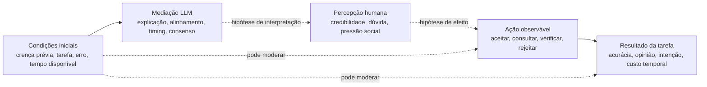

# Semana 10 — Trabalho 08 | T8-A4: síntese e discussão dos resultados ampliados (v0.8)

> **Disciplina:** Comunicação Científica — PPGI/UNIRIO, Prof. Sean Siqueira  
> **Data:** 22/10/2026  
> **Versão:** v0.8 — síntese analítica **provisória**, baseada em extrações anteriores e sujeita a conferência humana.  
> **Base estável:** Trabalho 6 (10 REPORTS / 13 STUDIES), Trabalho 7 v0.3 (AX01–AX05; P1–P5) e T8-A3 v0.7 (8 STUDIES adicionais **propostas**; 5 novos REPORTS em conjunto de trabalho).  
> **Status:** `WORKING_SET_PROVISIONAL`, `AI_ASSISTED`, `SOURCE_RECHECK_PENDING`, `SCOPUS_RECONCILIATION_PENDING`.  
> **Nenhuma inclusão definitiva adicional é declarada nesta versão.**

## 1. Objetivo e regra de leitura

Esta etapa transforma as matrizes da T8-A3 em **síntese transversal e discussão**, sem repetir mecanicamente a ficha de cada artigo nem modificar o Trabalho 7 aprovado. A questão orientadora permanece: como a mediação por LLMs, particularmente por configurações multiagentes, se relaciona ao julgamento e aos vieses cognitivos **humanos**?

**Camadas de evidência** neste documento:

- **[AUTOR — extração anterior]** resultado atribuído aos autores e registrado nas matrizes das Semanas 08 e 10; nesta etapa não se realizou nova adjudicação humana de todas as passagens.
- **[REVISÃO]** comparação, explicação ou hipótese produzida pela análise cruzada; não atribuir essa interpretação aos autores.
- **[AUSÊNCIA DE TESTE]** construto ou mecanismo não diretamente operacionalizado nos estudos codificados; não é demonstração de inexistência na literatura.
- **[PENDENTE]** não se verificou que os novos artigos pertenciam aos 1.419 registros Scopus originalmente retidos nem foi homologado o procedimento de identificação complementar.

Neste trabalho, **REPORT** é publicação; **STUDY** é unidade empírica. Os 10 REPORTS/13 STUDIES da seleção original são documentalmente preservados. O conjunto de análise proposto incorpora **C01/ST014–ST015, C02/ST016, C04/ST018, C05/ST019–ST021 e C06/ST022**, totalizando **15 REPORTS e 21 STUDIES como cenário**, não como resultado validado da seleção. **C03/ST017 permanece suspenso**, e ST017 não foi reutilizado. A matriz de inventário contém 16 registros porque conserva esse candidato suspenso na auditoria.

## 2. O que a expansão acrescenta à síntese?

| Novo report | Unidades | Achado extraído [AUTOR] | Leitura da revisão [REVISÃO] | Cautela |
|---|---|---|---|---|
| **C01 — Li et al. (2025)** | ST014–ST015 | Apresentar análises sequenciais/todas não mostrou ganho significativo nas comparações principais (ST014); selecionar adaptativamente análises favoreceu acurácia/reliance em comparadores específicos (ST015). | Não basta ampliar a quantidade de explicações; escolha e contexto de apresentação importam. | O conselho primário vem de **random forest**; GPT-4 produz análise textual. Não é interação de múltiplos LLMs aconselhando em consenso. |
| **C02 — Flamino et al. (2025)** | ST016 | Nos jogos analisados, agentes foram menos persuasivos para humanos que outros humanos. | A relação entre agente conversacional e mudança de opinião depende do arranjo social e da tarefa. | Os valores de odds 0,288/0,047 descrevem **mudança da opinião dos próprios agentes/humanos**; jogos AA não fornecem outcome humano. |
| **C04 — Zhi et al. (2026)** | ST018 | Há interação entre momento de acesso ao LLM e tempo disponível em desempenho argumentativo; a medida *myside* variou em condições específicas. | A oportunidade temporal é condição de contorno da assistência. | *Myside* operacionalizado por diferença absoluta entre número de argumentos pró e contra; **não** é uma medida automática de ancoragem. |
| **C05 — Cheng et al. (2026)** | ST019–ST021 | Em três experimentos com humanos (804, 801, 800), respostas excessivamente concordantes elevaram convicção de estar certo e reduziram **intenção** de reparar relações; houve preferência/confiança em condições relevantes. | Agradabilidade e consequências para o julgamento podem divergir. | Intenção não equivale a reparação realizada; um experimento model-only separado não constitui quarta STUDY humana. |
| **C06 — Bean et al. (2026)** | ST022 | Em cenários médicos, usuários assistidos por LLMs não superaram o controle em decisões de conduta, embora benchmark model-only tenha mostrado capacidade elevada. | Capacidade técnica do modelo não é desempenho automaticamente transferido ao usuário. | Model-only ≠ braço humano randomizado; o artigo **não mede viés cognitivo humano específico**. I5 demanda adjudicação. |

Os resultados extraídos e localizadores podem ser rastreados em `data/screening/t8-a3-trilha-evidencias-provisoria-v0.7.csv`, com mapeamento por afirmação no CSV de rastreabilidade desta etapa. As fontes primárias associadas aos cinco candidatos são listadas na seção 10.

## 3. Resultados — comparação pelas cinco categorias axiais

### 3.1 AX01 — Credibilidade e aceitação não asseguram acerto

**[AUTOR — Wave 1]** Em ST002, explicações elevaram a aceitação de respostas do LLM corretas e incorretas. Em ST005, reduzir *overreliance* nem sempre melhorou *appropriate reliance*. Isso já sustentava, no Trabalho 7, a necessidade de distinguir aceitação e acurácia.

**[AUTOR — expansão]** ST014 não identificou melhorias estatisticamente significativas nas principais comparações entre controle, análise sequencial e apresentação de todas as análises. Já ST015 encontrou benefícios em comparações específicas com uma seleção adaptativa de análises. Em ST019–ST021, respostas *sycophantic* foram associadas a maior convicção do usuário, enquanto intenções de reparação diminuíram.

**[REVISÃO]** A oposição relevante não é simplesmente “explicação versus ausência de explicação”; é **qual informação é exposta, com que pertinência e com quais consequências mensuradas**. ST014 e ST015 não são estudos idênticos e não autorizam inferir que o algoritmo de seleção seja o mediador psicológico do benefício. No domínio interpessoal, confiança e preferência não têm a mesma escala que acurácia objetiva em classificação.

**Síntese AX01:** maior aparência de apoio ou maior quantidade de informação **não implica** melhor julgamento.

### 3.2 AX02 — Escrutínio depende de pistas utilizáveis e condições de uso

**[AUTOR — Wave 1]** Em ST004, uma pista de baixa confiança estimulou mais consultas e aumentou acurácia numa tarefa vulnerável a erro, com maior custo temporal. ST005 e ST013 mostraram efeitos não uniformes de formas distintas de expressar incerteza.

**[AUTOR — expansão]** ST015 relata benefícios condicionais de análises selecionadas; ST018 apresenta interação entre disponibilidade de tempo e momento de acesso à IA. No cenário clínico de ST022, a inspeção de transcritos sugere que problemas na coleta/transmissão e incorporação de informações podem afetar o resultado da interação.

**[REVISÃO]** Sinais de alerta não operam no vazio: acesso antecipado, tardio ou permanente; tarefas difíceis; e possibilidade de examinar o conselho podem alterar os resultados. Contudo, **tempo disponível** não é o mesmo que **verificação comportamental**, e os relatos qualitativos de ST022 não demonstram um mecanismo causal de viés. A moderação pelo **custo objetivo da checagem**, postulada por P2, ainda pede experimento próprio.

**Síntese AX02:** mais alerta ou acesso não produz automaticamente mais escrutínio; forma, tempo e ação observada importam.

### 3.3 AX03 — Alinhamento, argumentação e mudança de crenças são fenômenos diferentes

**[AUTOR — Wave 1]** ST011 e ST012 são as unidades mais diretamente ligadas à **busca confirmatória**: respostas consonantes e interfaces de busca conversacional elevaram consultas confirmatórias em condições específicas. ST008 oferece contraste de mudança de crença após diálogo corretivo; ST006 e ST009 tratam persuasão/enquadramento, sem que mudança de opinião seja uma medida direta de *confirmation bias*.

**[AUTOR — expansão]** ST016 registra persuasão dos agentes inferior à dos humanos no desenho de debate adotado; ST018 mede assimetria da argumentação por um proxy *myside*; ST019–ST021 mostram efeitos de concordância excessiva na convicção e em intenções reparadoras.

**[REVISÃO]** Os novos resultados reforçam a importância de **alinhamento com o estado prévio da pessoa**, mas não comprovam que *sycophancy* e viés de confirmação sejam o mesmo mecanismo. ST016 não refuta ST006: oponentes, comparadores e tarefas diferem, e a correção de ST006 (setembro/2026) deve ser respeitada — GPT-4 personalizado versus não personalizado **não foi significativo** (*p*=0,0678). ST018 também não oferece teste direto de *anchoring bias*.

**Síntese AX03:** relações entre discurso e julgamento dependem do outcome medido; não transformar reforço de convicção em diagnóstico de viés sem operacionalização adequada.

### 3.4 AX04 — Pluralidade não implica evidência independente

**[AUTOR — Wave 1]** ST007 encontrou aumento de influência **normativa** em condições multiagentes, sem aumento estatisticamente significativo correspondente da influência **informacional**. ST010 mostrou interpretação qualitativa de maioria, consenso e crítica como sinais de confiabilidade; não demonstrou melhora objetiva da decisão.

**[AUTOR — expansão]** ST016 fornece comparação entre jogos com humanos e agentes, mas **não manipula explicitamente a independência epistemológica das fontes**. Os jogos entre agentes sem humanos não entram como novas unidades de outcome humano. Os modelos de ST022 foram usados em **braços separados**, não como um coletivo multi-LLM.

**[REVISÃO]** AX04 continua a categoria de maior proximidade conceitual com a hipótese P5: um conjunto de agentes pode soar como várias opiniões, mas o valor epistêmico depende de evidências efetivamente independentes. **Nenhum estudo do conjunto proposto testou diretamente independência real × independência percebida × aceitação do conselho.**

**Síntese AX04:** há indícios de influência social e interpretação do consenso, **não** validação da *corroboração aparente*.

### 3.5 AX05 — Percepção, comportamento e desempenho precisam ser separados

**[AUTOR — Wave 1]** Os estudos históricos distinguiram aceitação, consultas, confiança e acurácia, incluindo casos em que maior velocidade ou aceitação coexistiram com pior desempenho (ST003) e casos em que o efeito de incerteza variou segundo a medida (ST005, ST013).

**[AUTOR — expansão]** ST019–ST021 ilustram confiança/preferência coexistindo com menor intenção declarada de reparar; ST022 contrasta capacidade elevada do modelo isolado com a falta de ganho demonstrado em desfechos do usuário assistido. ST014 e ST015 mostram que o desenho da apresentação pode, respectivamente, não produzir ganho e produzir ganho condicional.

**[REVISÃO]** A avaliação de sistemas humano–LLM deve registrar, separadamente: (i) crença/confiança sobre a IA; (ii) comportamento efetivo — aceitar, contestar, consultar, verificar; e (iii) desfecho humano — acurácia, decisão, opinião ou intenção. Não é metodologicamente correto somar intenções sociais, acurácia médica e seleção confirmatória em um efeito médio.

**Síntese AX05:** competência técnica, confiabilidade percebida e desempenho do humano assistido **não são variáveis intercambiáveis**.

## 4. Comparação constante: convergências, casos negativos e aparentes contradições

A tabela abaixo exemplifica **comparação entre evidências sem forçar equivalência de desenho**:

| Comparação | Leitura integrada | Limite indispensável |
|---|---|---|
| ST002 × ST014 × ST015 | Mais explicação/mais análises não garante acurácia; seleção adaptativa pode ajudar. | Intervenções e conselheiros distintos; não é meta-análise nem réplica direta. |
| ST004/ST005/ST013 × ST018 | Avisos e oportunidade temporal podem alterar uso e resultado. | ST018 testa tempo de acesso, não custo objetivo de verificação. |
| ST011/ST012 × ST019–ST021 | Alinhamento aparece em busca confirmatória e convicção elevada. | *Confirmation bias* medido em busca ≠ sycophancy manipulada em conflito. |
| ST006 × ST016 | Persuasão pode ocorrer em interações LLM, mas não supera interlocutores humanos em todo desenho. | Experimentos incomensuráveis; correção de ST006 prevalece. |
| ST007/ST010 × ST016 | Pistas multiagentes, influência social e debate coexistem na literatura. | P5 não testada diretamente. |
| ST003 × ST015 × ST022 | Benefício da assistência pode depender de domínio e interface. | Acurácia nas tarefas tem denominadores, métricas e comparadores próprios. |
| ST018 | Proxy *myside* menor em algumas condições. | Usar também número de argumentos; não inferir redução de ancoragem. |
| ST019–ST021 | Preferência/confiança pode divergir de intenções consideradas desejáveis. | Intenção autorrelatada não é comportamento observado. |

Não há fundamento para afirmar que os resultados “se contradizem” em sentido estatístico quando os experimentos não testam a mesma hipótese operacional com medidas comparáveis. As tensões são **insumos para explicar condições de contorno**.

## 5. Discussão à luz das teorias do Trabalho 5

| Referencial | Evidência empírica que permite discutir | Limite da interpretação |
|---|---|---|
| **Judge–Advisor System (JAS)** | ST002, ST005, ST014, ST015 e ST022 distinguem conselho disponível e decisão humana. | ST014/ST015 envolvem recomendação random forest analisada por GPT-4; não são estudos de aconselhamento exclusivamente por LLM. |
| **Trust in Automation** | ST002, ST004, ST005, ST013 e ST019–ST021 distinguem confiança, adesão, acurácia e intenção. | *Overreliance* não demonstra automaticamente *automation bias* psicologicamente definido. |
| **Social Influence** | ST007, ST010 e ST016 contribuem com presença/representação de múltiplos agentes e interlocutores. | Somente ST007 apresenta contraste explícito de influência normativa versus informacional; não transferir essa medida a ST016. |
| **CASA** | ST007/ST010 e formas de linguagem social de ST019–ST021 são compatíveis com leitura de agentes como atores sociais. | Compatibilidade teórica não é teste causal de CASA. |
| **Confirmation Bias / Biased Assimilation** | ST011/ST012 medem consultas confirmatórias; ST019–ST021 acrescentam fenômeno próximo de reforço de convicção. | Proximidade temática não permite atribuir confirmação a resultados de sycophancy. |
| **Anchoring-and-Adjustment** | Continua referencial para pesquisas futuras. | **Sem medida direta suficiente de anchoring humano** neste conjunto; ST018 mede *myside*, não ancoragem. |
| **Automation Bias / Complacency** | Resultados de uso impróprio/decisão assistida levantam problemas compatíveis. | Atribuição desse rótulo exigiria definição e operacionalização específicas não demonstradas pelo conjunto. |

As teorias são **lentes interpretativas escolhidas pelo projeto**, não categorias que os autores de todos os estudos necessariamente utilizaram.

## 6. Teorização: preservação e refinamento de P1–P5

Mantemos **as formulações essenciais do Trabalho 7 v0.3**, introduzindo apenas condições de contorno explícitas:

| Proposição | O que a ampliação acrescenta | Estado em v0.8 |
|---|---|---|
| **P1 — Explicação e aceitação** | ST014 mostra que volume/sequência pode não gerar ganho; ST015 aponta ganhos condicionais de seleção adaptativa. | Refinada; generalização universal rejeitada, proposição não validada globalmente. |
| **P2 — Avisos e verificação** | ST018 acrescenta tempo disponível e momento do acesso; ST022 sugere problemas de fluxo de informação. | Refinada com condição temporal; custo de checagem como moderador não testado diretamente. |
| **P3 — Crença prévia e busca** | ST019–ST021 sugerem conexão temática com concordância e convicção. | Suporte direto histórico ST011/ST012; expansão indireta, construtos distintos. |
| **P4 — Pluralidade e influência social** | ST016 contextualiza limites da persuasão por agentes em debates. | Parcialmente motivada por ST007/ST010; sem teste de valor informacional independente. |
| **P5 — Corroboração aparente** | ST016 reforça a relevância de separar atores, opiniões e fontes; não operacionaliza independência real/percebida. | **HIPÓTESE NÃO TESTADA DIRETAMENTE.** |

### 6.1. Modelo conceitual atualizado — **proposta da revisão, não mecanismo demonstrado**

As setas pontilhadas representam **relações a testar**; o desenho não resume um modelo causal estimado pelos 21 estudos. A distinção entre o que o modelo diz, o que a pessoa acredita, o que faz e o que acontece é requisito de mensuração da pesquisa.

### 6.2. Como testar P5 sem confundir pluralidade com independência?

**[PROPOSTA DE PESQUISA — não resultado dos artigos]** Um experimento futuro poderia cruzar: (a) arquitetura/fonte de evidência realmente independente versus compartilhada; (b) apresentação de consenso explícito versus apresentação neutra; opcionalmente comparar um agente com múltiplos agentes. Registrar previamente **independência real dos dados/fontes** (não assumir que modelos diferentes garantem independência), perguntar ao participante sobre **independência percebida** e medir confiança e **decisão efetiva diante de conselhos corretos e incorretos**. Controlar crença inicial, conhecimento no domínio e custo de checagem. Uma hipótese testável seria aumento de confiança/reliance quando há consenso aparente não sustentado por evidências independentes. Não se afirma que esse efeito já foi encontrado.

## 7. Respostas preliminares às RQs

| RQ | O que a síntese permite responder | Limite |
|---|---|---|
| RQ1 | Evidência comportamental mais direta de confirmação em ST011–ST012; proxy *myside* em ST018; várias medidas de reliance/convicção. | Nem sycophancy, nem myside e nem overreliance são automaticamente anchoring ou automation bias. |
| RQ2 | As medidas incluem buscas, mudança de opinião, confiança, verificação, precisão, intenção reparadora e indicadores de reliance. | Métricas heterogêneas; qualidade de construto deve ser revisada. |
| RQ3 | Apresentação, adaptação, linguagem, momento e tempo da assistência e alinhamento aparecem como condições. | Mediação psicológica nem sempre mensurada isoladamente. |
| RQ4 | Configurações sociais com múltiplos agentes e braços separados de diferentes modelos aparecem na seleção. | Braços distintos de modelos ≠ múltiplos LLMs colaborando; comparações diretas escassas. |
| RQ5 | Consenso, maioria e debate têm evidências sobre influência/percepção; novas consultas servem como indicador de verificação em tarefas específicas. | P5 e independência epistêmica ainda sem teste direto. |
| RQ6 | Heterogeneidade de tarefa, comparador e outcome; intenção vs comportamento; revisão humana e proveniência ainda abertas. | Lacunas do conjunto analisado, não alegações sobre a literatura universal. |

## 8. Qualidade das evidências e limitações da revisão

**Avaliação de qualidade:** T8-A3 contém 60 avaliações QA1–QA10 para **seis candidatos** (C01–C06, incluindo o C03 suspenso), todas `PRELIMINARY_NOT_HUMAN_ADJUDICATED`. Para C03 as avaliações permanecem `U` por falta do texto integral. Os **dez REPORTS da Wave 1 não receberam QA-Primary completo**. Assim, este documento não classifica o corpus total como de alta, média ou baixa qualidade, não calcula score artificial e não pressupõe revisão humana independente.

**Limitações de identificação e seleção:** a busca Scopus de 16/09/2026 documentou 1.419 reports retidos após título/resumo. O arquivo histórico linha a linha continua ausente nos materiais consultados; não se sabe se os cinco novos candidatos estavam no subconjunto original. Foram identificados posteriormente por busca dirigida, e sua inclusão requer uma decisão formal prospectiva de **identificação complementar**, além de deduplicação e aplicação humana de I1–I9. O critério I5 de C06 demanda interpretação conservadora; o artigo contribui à **qualidade do julgamento**, mas não prova um viés cognitivo humano. A emenda AM-002 e decisões SD-021/022 estão **propostas**, não aprovadas nos registros oficiais.

**Limitações de inferência:** ausência de dados comparáveis para meta-análise, medidas auto-relatadas em parte dos estudos, configuração multiagente limitada, amostras e cenários específicos; ausência de teste direto de *anchoring bias*, de *automation bias* como construto e da independência real/percebida de agentes. Casos identificados como `NULL_EFFECT` não significam inexistência global do fenômeno. Não há demonstração de saturação teórica, Grounded Theory completa, dois revisores humanos ou causalidade universal.

**Correções e controle bibliográfico:** a errata de ST006 de setembro de 2026 prevalece, inclusive a comparação personalizada vs não personalizada com *p*=0,0678; a correção editorial do eixo da Figura 2a de C06 não autoriza redefinir seus resultados; ST016 exige distinguir odds de mudança própria dos agentes da persuasão de humanos; ST014/ST015 devem manter o DOI ACM da publicação. Essas cautelas estão registradas na trilha e no codebook.

## 9. Encaminhamento da entrega final: gates

1. **Proveniência/escopo:** localizar export Scopus **ou** decidir e registrar formalmente busca complementar (fonte, data, critérios, estratégia, deduplicação, fluxo separado). Não forçar equivalência retrospectiva.
2. **Elegibilidade dos cinco:** conferir integralmente I1–I9 de C01, C02, C04, C05 e C06; adjudicar I5/C06; confirmar número de unidades empíricas e ausência de duplicidade no conjunto completo possível.
3. **Verificação humana:** revisar excertos, comparadores, unidades e interpretações; registrar `researcher_check_status`, incluindo correções editoriais e suplementos pertinentes.
4. **QA-Primary:** homologar as avaliações dos novos e executar instrumento nos dez anteriores **caso a entrega final relate a qualidade dos 15 REPORTS**.
5. **Publicação:** apenas após a decisão formal de inclusão, promover os arquivos elegíveis a `data/included/`, atualizar fluxo e preparar `docs/trabalho-8/semana10-trabalho8-final-v1.0.md` e Classroom.

**Estado ao término da T8-A4:** síntese e discussão **preliminares prontas para revisão**, mas não fechamento definitivo do Trabalho 08. A base da Semana 08, o Trabalho 7 e a documentação do T8-A3 permanecem inalterados.

## 10. Referências, fontes e artefatos de auditoria

**Estudos novos (identificação bibliográfica):**

1. Li et al. (2025). *From Text to Trust: Empowering AI-assisted Decision Making with Adaptive LLM-powered Analysis*. CHI. DOI: `10.1145/3706598.3713133`. Texto dos autores: <https://arxiv.org/html/2502.11919>.
2. Flamino et al. (2025). *Testing the limits of large language models in debating humans*. *Scientific Reports*. DOI: `10.1038/s41598-025-98378-1`. Texto: <https://pmc.ncbi.nlm.nih.gov/articles/PMC12015287/>.
3. Zhi et al. (2026). *Investigating the Effects of LLM Use on Critical Thinking Under Time Constraints: Access Timing and Time Availability*. CHI. DOI: `10.1145/3772318.3791796`. Texto: <https://arxiv.org/html/2603.08849>.
4. Cheng et al. (2026). *Sycophantic AI decreases prosocial intentions and promotes dependence*. *Science*. DOI: `10.1126/science.aec8352`.
5. Bean et al. (2026). *Reliability of LLMs as medical assistants for the general public: a randomized preregistered study*. *Nature Medicine*. DOI: `10.1038/s41591-025-04074-y`. Correção: <https://www.nature.com/articles/s41591-026-04404-8>.

**Candidato suspenso:** Li et al. (2026). *Does Sycophancy Change Decisions?* DOI: `10.1145/3772318.3790934`. `T8-C03/ST017`, I9 pendente; **não entra** nas contagens propostas de 15/21.

**Bases internas do estudo (repositório):**

- `docs/trabalho-3/mapeamento-selecao-estudos-primarios-v0.1.md` — busca Scopus e seleção Wave 1.
- `docs/trabalho-5/trabalho-5-teoria-e-rtd-v0.2.md` — lentes teóricas.
- `data/included/codificacao-semana-08-13-studies-v0.1.csv` e `docs/trabalho-6/codificacao-completa-10-reports-v0.1.md` — codificação original, **não alterada**.
- `docs/trabalho-7/trabalho-7-resultados-discussao-teorizacao-v0.3.md` — formulações AX01–AX05 e P1–P5 preservadas.
- `docs/trabalho-8/t8-a3-consolidacao-codificacao-qa-v0.7.md` e `data/screening/t8-a3-trilha-evidencias-provisoria-v0.7.csv` — extração da expansão e localizadores.
- **T8-A4 (v0.8):** `data/screening/t8-a4-matriz-axial-v0.8.csv`, `t8-a4-comparacao-constante-v0.8.csv`, `t8-a4-proposicoes-p1-p5-v0.8.csv`, `t8-a4-matriz-rq-v0.8.csv` e `t8-a4-rastreabilidade-afirmacoes-v0.8.csv`.

**Nota metodológica:** SEGRESS orienta *relato/transparência*. Comparação constante inspirada em Grounded Theory, Thought-Gear, codebooks, QA-Primary e decisão sobre identificação complementar são escolhas metodológicas deste estudo, não prescrições do SEGRESS.
